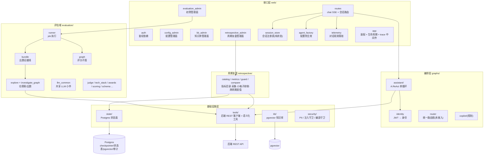
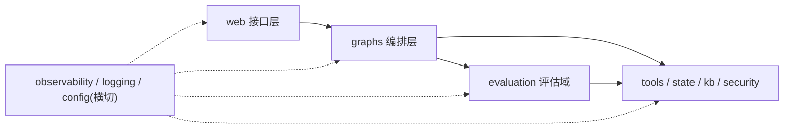
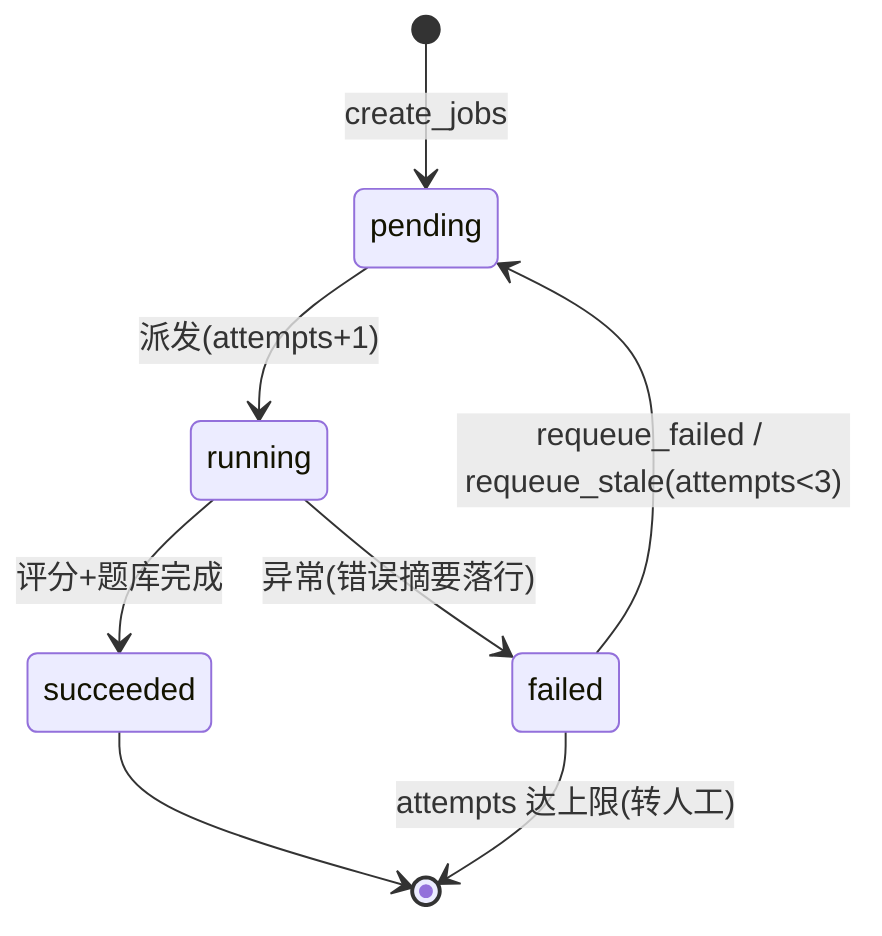
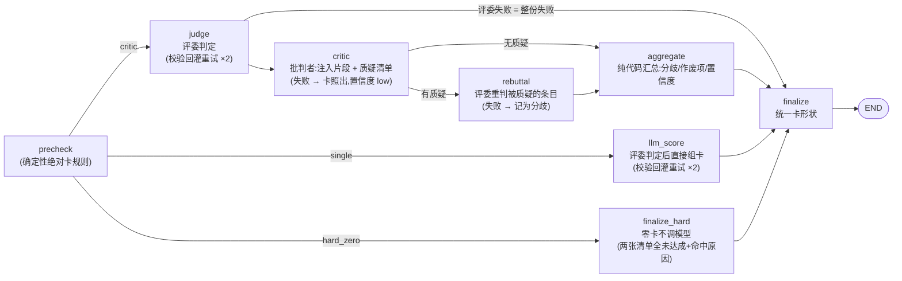
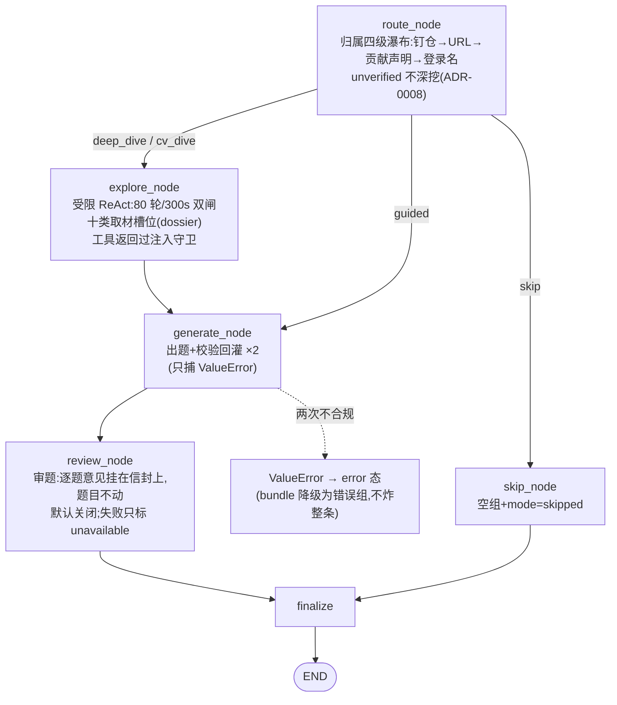
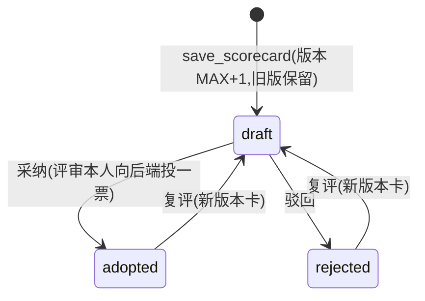
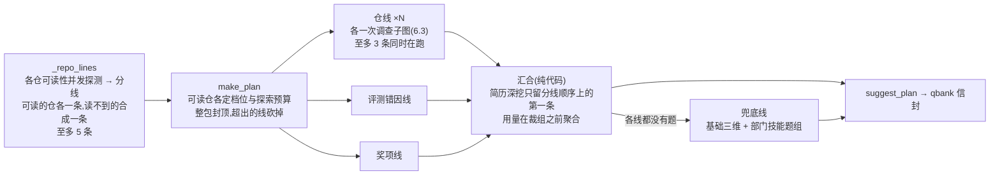
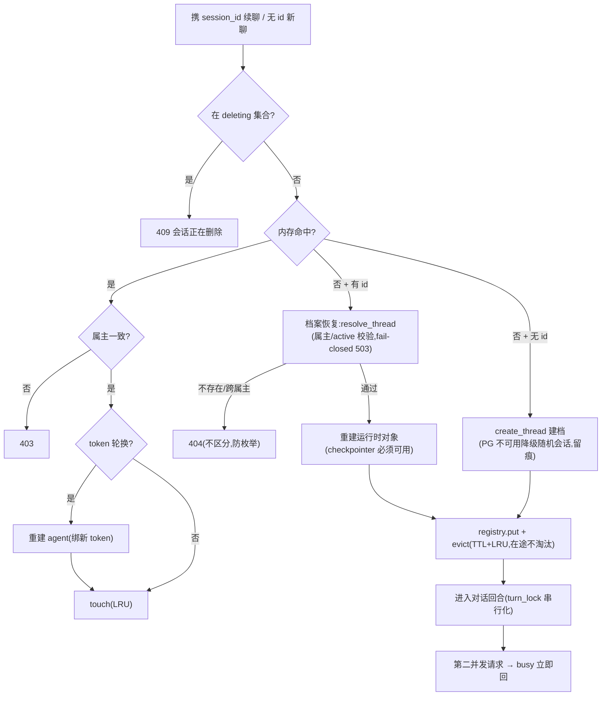
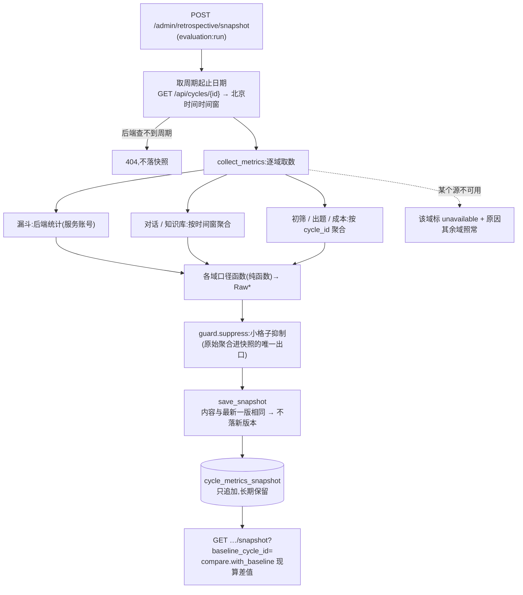
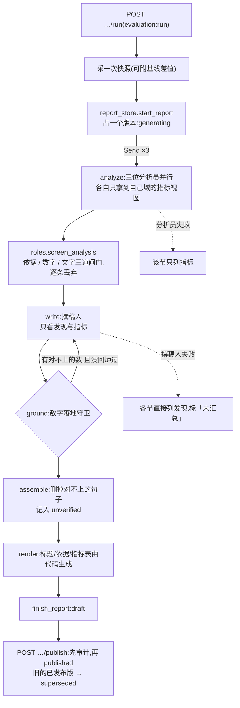

# 代码架构详解

> **这是什么**:本仓代码结构的深度导览——分层、包结构、设计模式、复杂业务逻辑的图形化表示。
> **何时读**:接手模块、评审设计、排查跨层问题之前;`docs/design.md` 讲"做什么与为什么",
> 本文讲"代码怎么组织、怎么流转"。
> 图为 Mermaid,与代码的对应关系以**符号名**标注,重构后以代码为准。

## 1. 总览:四层骨架 + 三个能力模块



三个能力模块共用同一套工具层与状态设施(ADR-0003:入口各自直连,无统一意图路由):

| 模块 | 入口 | 编排 |
|---|---|---|
| A 对话助理 | 官网 SSE / CLI | `graphs/assistant` ReAct 单循环 |
| B 评估流水线 | 管理面 / 启动自动恢复 | `evaluation/runner` + LangGraph 子图 |
| C 面试官 Copilot | 官网管理端(规划) | `graphs/copilot`(预留) |

三个模块之外还有一条管理面触发的离线批处理:**周期指标快照**(`retrospective/`,纯代码聚合,
不含模型),见 §11。

## 2. 包结构

```
src/official_agent/
├── web/                    # 接口层:FastAPI 路由与入口横切
│   ├── app.py              #   create_app:lifespan(自举/恢复/后台任务)+ trace 中间件 + 路由注册
│   ├── routes.py           #   /chat SSE、/sessions 会话路由、/admin/conversations 运营视图
│   ├── auth.py             #   authenticate(JWT→身份)+ require_any 权限工厂(唯一出处)
│   ├── session_store.py    #   进程内会话注册表:TTL+LRU 淘汰、删除中协调(零 FastAPI 依赖)
│   ├── agent_factory.py    #   配置指纹比对 → agent 热重建
│   ├── telemetry.py        #   conversation_log 落账、KB 引用锚收集、usage/前缀指纹
│   ├── config_admin.py     #   /admin/config:低敏热改 + 高敏掩码 + base_url 白名单
│   ├── kb_admin.py         #   /admin/kb*:知识条目 CRUD/入库重嵌
│   ├── evaluation_admin.py #   /admin/evaluation*:触发/队列/维卡/采纳/驳回/题库
│   ├── retrospective_admin.py # /admin/retrospective/*:指标快照采集与读取;报告生成/审阅/发布
│   └── org_memory_admin.py #   /admin/org-memory*:组织记忆的勾选/退役/续期/列表
├── graphs/                 # 编排层:LangGraph 图
│   ├── assistant/          #   A:build_assistant_agent(create_agent ReAct)+ 会话压缩
│   ├── identity.py         #   JWT → ResolvedIdentity(权限码/角色/属主)
│   ├── router.py           #   统一路由图(预留,未接入)
│   └── copilot/            #   C:面试官 Copilot(预留)
├── evaluation/             # 评估域:流水线领域逻辑
│   ├── runner.py           #   EvaluationRunner:submit/派发/_execute_job(评分段+题库段)
│   ├── graph.py            #   评分子图,按评分模式装配:single = precheck→llm_score→finalize;
│   │                       #   critic = precheck→judge→critic→(rebuttal)→aggregate→finalize;
│   │                       #   panel = 五路评委→collect→critic→(rebuttal)→aggregate→chair(缺省不启用)
│   ├── panel/              #   初筛合议:critic(批判者,只举手不改判)/ judges(拆开的评委与答辩)/
│   │                       #   aggregate(纯函数汇总:分歧、作废项、置信度)/ chair(主席写整体理由)/
│   │                       #   criteria(判定标准截自评分 prompt)/ anchors + harvest(校准案例的规则)/ shapes
│   ├── calibration.py      #   校准案例(往届判例)的 IO 编排:取判例/录种子判例/收割往届一致卡(缺省关闭)
│   ├── grounding.py        #   落地校验:引文是否在原文里、两段文本是否重叠
│   ├── material.py         #   简历材料进 prompt 的统一排布(报名信息 + 简历全文,包数据区)
│   ├── investigate_graph.py#   调查出题子图:route→explore→generate(含 skip/guided 分支)
│   ├── bundle.py           #   出题证据线:仓线/评测错因线/奖项线并发跑,汇合后按需兜底 → qbank 信封
│   ├── explore.py          #   受限 ReAct 仓探索(轮数/墙钟双闸 + dossier 槽位)
│   ├── plan.py             #   探索计划:档位→预算的映射、整包封顶、规划者(默认关闭)
│   ├── question_review.py  #   审题:出题之后逐题给意见,只标注不改题(默认关闭)
│   ├── question_similarity.py # 题目相似度标注:本包跨线查重 + 跨简历通用题(默认关闭)
│   ├── judge.py / tech_stack.py / awards.py   # 专项出题
│   ├── scoring.py          #   绝对卡短路 + 清单派生 0-10 分
│   ├── grading.py          #   同部门候选池内相对分级(优秀/良好/一般)+ 调剂建议/面试提示
│   ├── applicant.py        #   报名信息解析(志愿部门/专业/年级)
│   ├── schema.py           #   数据契约(ScorecardOutput/QbankV2/QuestionGroupV2...)
│   ├── llm_common.py       #   共享小件:content_text/extract_json/prompt_version/温度定档/
│   │                       #   invoke_with_retry/add_usage/模型并发闸
│   ├── runner 依赖的 github_client / autograding / attribution / dossier
│   └── state/evaluation/(见 state/)
├── state/                  # 基础设施:Postgres 状态面(Repository 语义)
│   ├── pg.py               #   checkpointer 连接 + 挂起载荷清理
│   ├── threads.py          #   agent_threads:会话档案(建档/属主校验/硬删)
│   ├── conversation.py     #   agent_conversation_log:对话日志 + usage 解包
│   ├── evaluation/         #   包:scorecard_store / job_store / review_queue / calibration_store /
│   │                       #   bootstrap / _connection(池)
│   ├── qbank.py            #   interview_qbank:题库 + pick_log
│   ├── qbank_index.py      #   qbank_question_index:题目向量索引(pgvector,惰性自举)
│   ├── audit.py            #   agent_audit_log:审计(五字段,ADR-0006)
│   ├── config_store.py     #   agent_config:热配置(DB 覆盖 env)
│   └── retrospective/      #   包:snapshot_store(cycle_metrics_snapshot,只追加)/ aggregates(各域只读聚合)
│                           #       / report_store(cycle_retrospective:报告版本与发布状态机)
├── tools/                  # 基础设施:后端 REST 的语义化封装
│   ├── client.py           #   BackendClient + 异常层级(AuthError/UnavailableError/BackendError)
│   ├── readonly.py         #   只读工具(按意图命名,60 秒按来问者缓存)
│   ├── projection.py       #   工具返回投影(只留回答要用的字段,姓名/打分不进)
│   ├── envelope.py         #   统一信封 {status: ok|error|unavailable, hint}
│   ├── write.py            #   写工具(官网通道:确认卡片 → 指纹核对 → 意图审计 → 本人令牌执行 → 结果审计)
│   └── knowledge.py        #   search_knowledge(知识库检索,降级契约;解析开放周期、落检索日志)
├── kb/                     # 知识库:chunking / embedding / keywords(分词) / schema / store(混合检索+周期过滤)
│                           #   / query_log(kb_query_log:每次检索的结局与门槛前最高分)
├── memory/                 # 长期记忆:store(agent_memory 表) / extract(后台提取+闸门) / recall(注入 system 末尾)
│                           #   组织记忆:org_store(org_memory 表,人勾选才写入);recall 里按角色定可见范围
├── retrospective/          # 周期复盘:catalog(指标目录:id/名字/口径) / metrics(各域口径函数+collect_metrics)
│                           #   / guard(小格子抑制) / compare(跨周期差值,跨指标定义版本拒绝)
│                           #   / views(分析员的指标视图) / roles(四个角色的输出结构与闸门)
│                           #   / grounding(数字落地守卫) / graph(扇出→撰稿→守卫回炉→成稿)
│                           #   / render(Markdown 渲染) / reports(后台生成任务)
│                           #   / lessons(候选教训勾选成组织记忆的闸门)
├── security/               # 横切:pii(脱敏)/ injection_guard(数据区+扫描)/ fabrication_guard
├── prompts/                # prompt 唯一权威(一图一节点一文件 + frontmatter,ADR-0004)
├── evals/                  # eval 集 + 统一 runner(python -m evals / evals/run_evals.py)
├── observability.py        # Langfuse 接线(fail-open)+ trace id(contextvar/W3C)+ PII 遮蔽 handler
├── config.py               # Settings(env)+ HOT_KEYS + get_effective_settings(DB 覆盖)
├── credentials.py          # 服务账号凭证(0600 文件)
├── logging_conf.py         # 日志(stdout+落盘,TraceIdFilter 注入 trace_id)
└── cli.py / mcp_server.py  # CLI 入口 / MCP 对外暴露(维护态)
```

## 3. 依赖规则



- **单向向下**,禁止反向与跨层跳跃;领域规则不 import 基础设施实现细节
- **接口层只做编排**:校验 → 调用 → 组装;业务规则在 evaluation/编排层,不在 route
- **基础设施不感知上层**:tools 不知道 graphs,state 不知道 web
- 例外与边界:web/telemetry 可以 lazy import `state.conversation`(观测面,函数内导入保持
  "web 入口无 PG 可跑"纪律)
- `retrospective/` 与 `evaluation/` 同级:由 web 调用,向下只依赖 tools/state/security,
  以及 `evaluation.schema` 里的部门清单常量;不 import 任何图或 runner

## 4. 设计模式与惯用法(模式 → 落点)

| 模式/惯用法 | 落点 | 说明 |
|---|---|---|
| **权限工厂**(Factory + 闭包) | `web/auth.require_any(*codes)` | 生成 FastAPI 依赖;单码直接 `require_any("code")`,消灭五份复制品 |
| **构造器注入** | `agent_factory.ensure_fresh_agent(build_agent=...)` | 重建构造器由调用方注入,模块不绑定装配实现 |
| **双检锁单例** | `evaluation/bootstrap.ensure_once`、`_connection.get_pool`、`routes._get_model_gate` | 每进程一次的自举/懒建资源 |
| **哨兵对象** | `job_store._Unset` | 区分「没传这列」与「显式置 NULL」,mark_job 只更新显式列 |
| **状态机** | evaluation_job / scorecard | 见 §6.4;部分唯一索引兜底活跃唯一性 |
| **管道/子图** | LangGraph 三图 | 见 §6.2/6.3;节点纯函数 `(state) -> dict` |
| **校验回灌重试** | `llm_common.invoke_with_retry` | 只捕 ValueError 回灌模型自纠;程序缺陷向上暴露 |
| **降级双轨** | 观测 fail-open / 写路径 fail-closed(ADR-0005) | 每处降级必须留痕(日志),注释说明为什么安全 |
| **Repository 语义** | `state/*_store` | 方法名说业务(`find_active_users` 式),SQL 不上浮 |
| **投影(读模型)** | `review_queue.list_review_queue` | DISTINCT ON 最新卡 + LATERAL 归属/决策历史 |
| **装饰式包装** | `_PiiMaskedLangfuseHandler` | 委托 Langfuse handler,消息/载荷统一脱敏(fail-closed) |
| **端口适配** | `tools/client.py`(后端 REST)、LLM 统一经 `build_model` | 第二实现出现才抽接口(YAGNI,ADR-0009) |
| **参数注入时钟** | `session_store.evict_locked(now)`、压缩判定 | 可测性根基:测试不 sleep |

## 5. 对话回合(A 模块主链路)

```mermaid
sequenceDiagram
    participant C as 客户端
    participant W as web/routes
    participant SS as session_store
    participant AF as agent_factory
    participant A as assistant graph
    participant TL as tools/(后端 REST)
    participant T as telemetry

    C->>W: POST /chat(message, session_id?)
    W->>W: JWT 鉴权 + ChatBody 校验
    W->>SS: 取会话(内存命中/档案恢复/新建建档)
    W->>AF: 配置指纹比对(变则重建 agent)
    W-->>C: event: session(created)
    W->>W: 模型并发闸 + 墙钟超时
    loop 流式消费(astream 双模式)
        A->>TL: 工具调用(只读直连/写操作 interrupt)
        Note right of TL: search_knowledge 每查一次<br/>后台落一行 kb_query_log(fail-open)
        A-->>W: delta 块(PII 掩码逐块) / tool 事件 / usage 终块
        W-->>C: event: delta / tool
    end
    opt toolless 回复
        W->>W: 编造守卫 → 改写/放行
    end
    W->>W: 轮末压缩(超阈值,摘要回写 checkpoint)
    W->>T: conversation_log 落一行(带轮级 trace_id 与守卫判定;to_thread,fail-open)
    W-->>C: event: done(带 sources 引用锚) 或 error(稳定文案+trace_id)
```

失败收敛:闸满(busy)/超时(timeout)/断连(client_disconnected)/异常(按异常类型分类)
五条路径都收敛到**同一落账点**,客户端只见稳定错误码。

## 6. 评估流水线(B 模块)

### 6.1 job 生命周期

```mermaid
flowchart TD
    S["POST /admin/evaluation/run"] --> AUTH["权威归属核对<br/>(后端按简历号派生 user_id)"]
    AUTH -->|"错位 → SubmissionDataError → 400"| FAIL
    AUTH --> CJ["create_jobs(幂等:活跃 job 复用<br/>部分唯一索引兜底,逐条事务)"]
    CJ --> D["派发(_sem 并发闸)"]
    D --> P["pending"]
    P --> R["running(attempts+1,简历状态 6)"]
    R --> SC["评分段 _do_scoring<br/>取数→归属硬断言→脱敏→评分子图→落卡"]
    SC --> QB["题库段 _do_qbank<br/>出题 bundle→落库→用量日志"]
    QB -->|成功| OK["succeeded<br/>(card_version + qbank_status)"]
    QB -->|题库线失败| OKF["succeeded + qbank_status=failed<br/>(评分卡有效,原因直达管理面)"]
    SC -->|失败| F["failed(error 摘要,<br/>简历状态回 2,可重试)"]
    F -->|requeue(attempts<3)| P
    F -->|attempts 达上限| MAN["人工队列"]
```



### 6.2 评分子图(hard_zero 短路,按评分模式装配)



评分模式(`evaluation_scoring_mode`:`single` / `critic` / `panel`)**按周期固定**:一个周期最早落库
的那张卡用了哪种模式,之后的 job(含重评)都沿用,不再读配置——等级是池内相对排名,同一个
池里的卡必须出自同一种模式。`critic` 模式下批判者没有改判权:被质疑的条目交回评委重判,
评委维持原判就只记为分歧。唯一由代码直接改判的情形是达成项的引文落在批判者指出的注入
片段里。分歧只产出**置信度**(`low / medium / high`,落在卡的 `panel` 块里),不进分数与
等级;评审队列按低置信在前排序,并有 `low_confidence` 子队列。

`panel` 模式(上图未画,**缺省不启用**)在 `critic` 的基础上把评委拆开:四位部门评委各判一张
部门清单、一位认真程度评委判认真程度清单并给态度,用 `Send` 五路并行、各自独立上下文;
任何一位评委失败即整份失败。批判者之后的答辩按清单分派给各自的评委,整体理由改由主席在
汇总之后写(只看最终判定,不看简历;失败则用程序模板)。启用条件见
`docs/proposals/screening-panel.md`「P2 落地」。

校准案例(往届判例,**缺省关闭**)是评委 prompt 末尾的一段参考:runner 在评分子图之前按
判定项从案例库里取与简历最相似的判例(每项至多一条达成、一条未达成),传给评分子图。
案例集按周期冻结(周期开跑时记下案例号水位),不用本周期与本简历的案例;判例入库时过
注入扫描与脱敏,进 prompt 时包数据区。取不到判例不挡评分。

初筛看两个维度,互不折算:**部门匹配度**(四个部门的录入标准清单都判,志愿部门那张
决定匹配度,其余用于调剂建议)与**认真程度**(内容充实/了解社团部门/意愿真挚/成文/
不套话)。模型只逐项判定达成与否并给原文引文,两维 0-10 分由清单权重派生落卡;
「优秀/良好/一般」**不落库**,读取时由 `grading.grade_pool` 按「周期 + 第一志愿部门」
分池相对划分(头尾各约两成;池子不足 15 人改用绝对锚点;媒体部与综合部各自成池)。
数值分仅 `evaluation:score:view` 可见。

### 6.3 调查出题子图(route → explore → generate → review)



explore 的工具执行内循环(`_run_tool_calls`):逐调用判**轮数/墙钟双硬闸**,dossier 槽位满
则静默丢弃并回执模型;ToolMessage 严格紧跟 tool_calls(OpenAI 消息序纪律)。

### 6.4 scorecard 状态机



### 6.5 出题 bundle:证据线并发与汇合



三路证据线同时跑(`asyncio.gather`),线与线之间不共享可变状态:每条仓线是一次独立的子图调用,
档案与消息历史都在线内,一个仓里的文本进不了另一条线的模型上下文。跨线的约束全部在汇合处由
代码裁决,所以信封里组的顺序固定为仓线(简历里的出现序)→ 评测 → 奖项 → 兜底,与谁先跑完
无关。单线失败只损失该线:仓线留 `mode=error` 的错误组,评测线与奖项线缺席。

并发有两处封顶,数值都在代码里:一个 bundle 里同时在跑的仓线至多 3 条
(`bundle.MAX_PARALLEL_REPO_LINES`);进程内同时在途的 GitHub 请求至多 4 个
(`github_client.MAX_CONCURRENT_REQUESTS`,所有 client 共用——各线各建各的 client,却共用同一个
令牌的速率配额)。模型调用另有一把评估域共用的进程级闸(`llm_common.model_gate`,上限
`EVALUATION_MODEL_CONCURRENCY`,默认 8):评分、探索、出题、审题都先过它,所以 4 个 job 同时在
题库段时峰值是 8 而不是 4 ×(3 条仓线 + 评测线)= 16。排队等闸的时间不计入探索的墙钟预算。

起线之前先定探索计划(`evaluation/plan.py`):每条可读的仓线一个档位(`high` / `normal` /
`low`),档位由代码映射成探索的轮数与墙钟预算,`high` 就是探索段的缺省上限;各线预算之和再过
整包上限(`QBANK_EXPLORE_MAX_TOTAL_TURNS` / `…_WALL_SECONDS`),超出的从最低档的线开始降档直至
砍掉。档位可以由规划者(单次模型调用,`QBANK_PLAN_MODE`,默认关闭)来选,它只能在固定集合里
取值,选不了预算数值;关着或失败时每条线都是 `high`。计划连同各线实际用掉的轮数与时间记在
信封的 `plan` 里。

题库落库前后各有一步可选的相似度标注(`question_similarity`,默认关闭):落库前给题目算向量,
把本包里跨线重复的题、本周期多份简历都出过的题标在信封顶层;落库后把向量写进
`qbank_question_index`。审题意见与相似度标注都挂在题组旁边而不是题目对象里,
`flatten_v2_pickable` 读出可挑题视图时再并到题上。两步都是旁路:失败只是没有标注。

## 7. 会话生命周期(web)



## 8. 数据模型(Postgres,agent 侧)

| 表 | 内容 | 关键约束 |
|---|---|---|
| `agent_threads` | 会话档案(thread_id/属主/状态) | thread_id 全局唯一;软删+保留期清理 |
| `agent_conversation_log` | 对话日志(问题摘要/工具/耗时/usage/轮级 trace_id/守卫判定) | fail-open 写入 |
| `evaluation_scorecard` | AI 参考分卡(card JSONB/total/hard_zero;critic / panel 模式的卡带 `panel` 块:模式/置信度/注入片段/分歧) | UNIQUE(resume,cycle,card_version);状态机 CHECK |
| `evaluation_job` | 执行 job(状态机/attempts/qbank_status) | 部分唯一索引:活跃 job 每 (resume,cycle) 一条 |
| `evaluation_calibration_case` | 初筛校准案例(条目级判例 + 向量 real[],记 embed_model) | 案例不可改,只能停用;同一张卡的同一判定项只入库一次;按周期用案例号水位冻结 |
| `interview_qbank` | 题库信封(v2 JSONB) | 版本递增 |
| `qbank_pick_log` | 面试官选题记录 | 服务端权威引用(防伪造证据路径) |
| `qbank_question_index` | 题目向量索引(每道可挑的题一行) | 每行记 embed_model,不跨模型比较;一份简历只留最新一版 |
| `agent_audit_log` | 审计(ADR-0006 五字段) | 代理身份+trace_id |
| `agent_config` | 热配置低敏键 | 白名单 HOT_KEYS |
| `kb_source` / `kb_faq` / `kb_doc` / `kb_chunks` | 知识库来源/内容/向量 | 禁跨 embedding 模型混排;`kb_source.cycle_id` 非空的条目只在该招新周期开放时进检索 |
| `kb_query_log` | 对话里每次知识库检索一行(脱敏后的问题/结局/门槛前最高分/命中条目/生效周期) | fail-open 写入;按 `thread_id` 随会话删除;`trace_id` 关联对话日志 |
| `cycle_metrics_snapshot` | 每个招新周期的指标快照(过了小格子抑制的聚合数 + 当时的指标目录) | UNIQUE(cycle,version),只追加;没有 `thread_id`,不随会话删除或保留期清理 |
| `cycle_retrospective` | 周期复盘报告(结构化正文/Markdown/被守卫删掉的句子/prompt 版本) | UNIQUE(cycle,version);状态机 CHECK;部分唯一索引:每周期至多一份已发布、一份在生成 |
| `org_memory` | 组织记忆:已发布报告里经管理员勾选的教训(可见范围/保质期/出处/向量) | 只由人工动作写入;部分唯一索引:同一条候选教训至多一条生效;过期保留不召回 |

## 9. 横切机制

- **trace 串联**:三入口(web 中间件/CLI/eval job)置轮级 id(归一 W3C 32-hex)→
  出站 `traceparent` → 审计 trace_id → 日志 `[trace_id]`,四面同 id(ADR-0012)。
  对话日志与知识库检索日志存的是入口那个 id(`observability.turn_trace_id`),两表按它
  关联;Langfuse 开启时图内取到的是 span 的 id,与入口 id 不同(见
  `docs/proposals/kb-ops-loop.md` D1)
- **PII 分层边界**:工具出口 `mask_pii_deep` → trace 采集侧遮蔽(handler)→ 模型输出
  侧守卫 → 挂起载荷 TTL
- **错误分类**:类型判定(`BackendAuthError`/`BackendUnavailableError`/`BackendError`)→
  稳定错误码;受控领域文案是对外契约,未预期异常原文不出边界(ADR-0011)
- **配置热生效**:PUT /admin/config → DB upsert + 缓存失效 → 每轮指纹比对 → 变则重建
  agent(`agent_factory`,读取失败留痕降级)

## 10. 测试与质量门禁

| 层 | 位置/命令 | 把关内容 |
|---|---|---|
| 单测 | `uv run pytest`(709+) | 确定性逻辑:工具/图结构/权限/脱敏/状态面(mock 连接) |
| 集成 | pgvector 容器 + `POSTGRES_URL=... pytest tests/*_pg.py tests/test_kb_integration.py` | DDL 幂等/唯一索引/事务边界/锁纪律(自 SKIP 不算通过) |
| eval | `python evals/run_evals.py` | 工具选择/参数红线(forbidden_tools)、阈值门禁、LLM-as-judge、初筛评分基线(区间一致率/条目翻转率/注入拦截率) |
| 机械 | `uv run ruff check .` | lint(line-length 100) |

评分分级可见与客服面红线有专门保证测试:`test_no_role_assembles_score_tools`
(装配层)、`test_assistant_surface_never_imports_evaluation_store`(tripwire)、
`ts-score-not-exposed-*`(eval 行为红线)。

## 11. 周期指标快照(管理面触发的离线批处理)



- **数字全部由代码算**:这条链路没有模型调用。指标目录(`retrospective/catalog.CATALOG`)给每个
  指标稳定 id、名字与口径;口径一改就升 `METRICS_SCHEMA`,不同版本的快照拒绝对比(409)。
- **只进聚合数**:原始聚合只能经 `guard.suppress` 变成快照里的值——计数小于 5(含 0)、
  能从比率或合计反推出小计数的格子都被抑制;对人的判定结果与各部门的格子固定出(缺席不等于 0),
  流程状态桶为 0 时不出格子;分布的键只放行标识符与部门白名单。
- **为什么是快照而不是现查**:对话日志与检索日志随会话删除而消失,周期结束时不留一份,
  这一届就没有基线。快照表不挂在任何清理路径上,存储模块也不提供删除或改写。
- **失败语义**:单个数据源不可用只让用到它的域缺席并在快照里标注(只给类别与异常类名);
  口径函数里的程序错误不算「数据源不可用」,照常抛出。
- 设计与取舍见 `docs/proposals/cycle-retrospective.md`。

报告生成接在快照之后(`POST /admin/retrospective/run`,后台任务):



- **模型只解读**:四个模型角色(prompt 在 `prompts/retrospective/`),交回来的每一条都要带指标 id、
  数字要在引用的指标里对得上、文字不含个人信息与指令样文本;不合格的逐条丢弃并留痕。
- **数字落地守卫**(`retrospective/grounding.py`)比对的是「这句话引用的指标」而不是整份快照;
  模糊量词与中文数字的人数一律按对不上处理。
- **任何一步失败都不让整份报告失败**:分析员失败 → 该节只列指标;撰稿人失败 → 直接列发现;
  生成任务本身出错 → 该版本 `failed`,不影响已有版本。
- **草稿只给有执行权的人看**;只有查看权的人只看得到已发布的版本。

组织记忆接在已发布的报告之后:管理员在 `POST /admin/org-memory/approve` 勾选一条候选教训
(可改写;文字要过长度、个人信息、指令样文本三道闸门),它才进 `org_memory`。之后每轮对话
与用户长期记忆一起召回,拼在 system prompt 末尾单独一段。

- **候选人零泄漏靠两道互不依赖的闸**:召回之前按角色白名单判(`memory/recall.org_memory_audiences`,
  候选人连库都不查);装配时只有管理员与社员的助理有这一段
  (`graphs/assistant._with_memories(allow_org_memories=…)`,缺省不放行)。
- **有保质期**:缺省一年;过期不再召回但行保留,列在下一份报告的「往届教训复核」里等人续期或退役。
- **两个默认关闭的开关**:`retrospective_report_enabled`(报告生成)与 `org_memory_enabled`
  (组织记忆召回)。对应的 eval 没在真实模型上跑过之前不打开;关着时指标快照照常可用。

## 文档地图

- 产品设计与决策背景:`docs/design.md` + `docs/adr/`
- 工程规范(分层/错误/日志/注释):`docs/standards/`
- 重构计划与进度:`docs/refactor-roadmap.md`
- 评测可观测 runbook:`docs/eval-observability.md`
