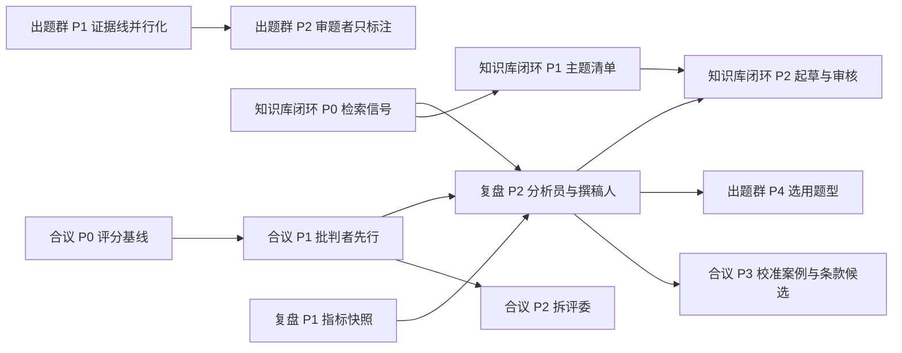

# 提案:多 agent 方向设计稿

> 状态:2026-11-11 起草。**知识库运营闭环的 P0 已实现**(检索信号落库与周期过滤,见该文 §10);
> **调查出题群的 P1 已实现**(证据线并发、汇合处去重、GitHub 请求并发闸,见该文 §10;真实模型下
> 的墙钟与质量对比尚未跑);**调查出题群 P2 的机制已实现但默认关闭、验收未完成**(审题者只标注、
> 题目索引;对应的 eval 没有跑过,见该文 §10);**调查出题群 P3 的机制已实现、规划者默认关闭、
> 验收未完成**(分档预算与整包封顶;规划 eval 的模型段没有跑过);**调查出题群 P4 的机制
> 已实现、两项都默认关闭、启用条件都没有满足**(审题拦截、选用题型范例;只用合成数据测过)。
> 其余各期都还是设计稿,没有对应实现,也没有排期。
> 立项时把定下来的决策写进 ADR 与 `docs/architecture.md`;做完或放弃的设计稿移入
> `docs/archive/`。与 ADR 冲突时以 ADR 为准。

## 为什么是这四个

多 agent 只放在**任务可拆、可并行、离线批处理**的地方。A 模块(对话助理)保持「身份解析 →
按角色装配工具 → ReAct 单循环」不动:ADR-0003 已经否决了统一意图路由,在线回合里再加一层
调度者只会增加延迟和不确定性。下面四份都落在 B 模块(评估流水线)或管理面触发的离线批处理上。

| 设计稿 | 一句话 | 新增的模型角色 | 用到的检索 / 记忆 |
|---|---|---|---|
| [知识库运营闭环](kb-ops-loop.md) | 把「没答好的问题」聚成主题,起草带出处的 FAQ,人审后入库 | 缺口甄别、起草、审核 | 查询日志聚类、草稿查重、按周期过滤 |
| [初筛多评委合议](screening-panel.md) | 一位评委一张清单 + 一位批判者,分歧变成复核优先级 | 部门评委 ×4、认真程度评委、批判者、主席 | 条目级校准案例(往届判例) |
| [调查出题群](investigation-swarm.md) | 规划者分预算,探索者并行取材,审题者逐题把关 | 规划者、审题者(探索者与出题者已有) | 题目索引查重、去标识的选用题型 |
| [招新周期复盘](cycle-retrospective.md) | 三位分析员并行读三个数据域,撰稿人汇总成一份报告 | 数据 / 问答 / 评估分析员、撰稿人 | 指标快照、组织记忆 |

## 共同约束

每个新增的模型角色都要满足下面十条,四份设计稿里不再逐条重复。
设计稿里的代码路径除非另外写明,都相对 `src/official_agent/`;「新」表示提案新增、现在还不存在。

1. **一个角色一个 prompt 文件**,放 `prompts/` 下对应子目录,带 frontmatter 版本(ADR-0004)。
2. **模型档位默认 strong**;想降到 light 必须先有 eval 证明(ADR-0004)。
3. **外来文本一律当不可信输入**:简历、用户提问、仓库内容、往届判例进 prompt 前都包进
   `security/injection_guard.wrap_data_zone`;工具返回过 `guard_tool_result`。
4. **PII 不出边界**:进模型前脱敏,落库与落报告前过 `security/pii.mask_pii` / `mask_pii_deep`。
5. **预算双闸**:受限循环沿用 `evaluation/explore.py` 的做法——轮数上限 + 墙钟上限,触顶即停并
   标记降级,不判失败。预算数值由代码定,不交给模型,更不交给候选人。
6. **结构化输出走「提示词 JSON + strict Pydantic」**,失败带纠错重试一次
   (`evaluation/llm_common.invoke_with_retry`)。现网代理上的思考模式模型不接受 `json_schema`
   响应格式与强制 `tool_choice`,所以不走那两条轨。
7. **判定归模型,数字归代码**:模型只判「达成与否」「保留还是丢弃」「是否有出处」;分数、等级、
   置信度、百分比全部由代码派生。
8. **共享状态只有人能发布**:agent 只写自己的草稿表;知识库条目、组织记忆、出题范例、prompt
   补充条款都要人确认后才生效。对后端的写操作仍走 `interrupt()` 指纹令牌(ADR-0005),
   这四份设计稿都不新增后端写工具。
9. **审计带上角色、节点与 prompt 版本**(ADR-0006),一次运行里用到的全部 prompt 版本随产物落库。
10. **先立基线再比较**:每个角色有 eval 用例;任何「更好」的说法都要对着同一份数据集上的旧基线说。

## 反复出现的三个模式

- **扇出再汇总**:LangGraph `Send` 把互不依赖的子任务并行发出去,各自在独立上下文里跑,只回传
  结构化结果;汇总节点尽量是纯代码。
- **独立审核者**:起草和审核由两个角色、两份 prompt 承担。审核者只看产物和证据原文,不看起草者
  的推理过程;审核者没有改写权,只能放行、打回或举手。
- **落地校验**:凡是模型声称「原文里有」的东西——引文、仓库路径、报告里的数字——都由代码回到
  来源里复核一遍。评分子图现有的引文校验(`evaluation/graph.py` 的 `_evidence_in`)是原型。

## 记忆分层(本目录的用词)

| 层 | 载体 | 现状 |
|---|---|---|
| 会话内 | checkpointer(Postgres) | 已有 |
| 滚动摘要 | 轮末压缩 | 已有 |
| 用户长期记忆 | `agent_memory`,按 `owner_user_id` 隔离 | 已有 |
| 案例记忆 | 校准案例、选用题型(向量检索) | 提案:初筛合议、调查出题群 |
| 组织记忆 | 跨届共享的经验结论,人审后生效 | 提案:周期复盘 |
| 程序性记忆 | `prompts/` 里的规则本身,经版本化与 eval 门禁演进 | 机制已有;提案只增加「候选条款」的来源 |

## 只建一次的基础件

- **评估域模型并发闸**:合议的评委扇出、出题群的探索者扇出、runner 的多 job 并行会叠乘。需要一个
  进程级信号量统一限住评估域的并发模型调用数,而不是各图各自限。**已建**(随出题群 P2):
  `evaluation/llm_common.py` 的 `model_gate()`,上限是配置项 `EVALUATION_MODEL_CONCURRENCY`
  (默认 8,初值,没有按模型供应商的限流实测过)。评估域里调模型一律走 `gated_ainvoke` 或
  `invoke_with_retry`(后者内部已经过闸),不要直接 `model.ainvoke`;自己带墙钟预算的受限循环
  照 `evaluation/explore.py` 的做法,把排队等闸的时间从预算里扣出去。
- **向量表纪律**:所有新向量表与知识库同规则——记录 `embed_model`,不跨模型混检,换模型即重算
  (ADR-0007:只用 Postgres + pgvector,不引入第二个向量库)。
- **落地校验工具函数**:把引文校验从评分子图里提出来,供知识库审核、校准案例、报告守卫共用。

## 依赖与建议顺序

1. **先做不加新角色的两件事**:出题群 P1(现有证据线并行化)与知识库闭环 P0(检索信号落库)。
   纯工程,立刻见效,且后面所有分析都依赖这些数据。两件都已实现;出题群 P1 还欠一次真实模型下
   的前后对比(该文 §10)。
2. **复盘 P1(指标快照)要赶在本周期结束前上线**,否则这一届的数据没有基线,下一届无从对比。
3. 合议 P0 / P1 可与上面并行;拆评委(P2)必须等基线出来、且在 eval 上赢了才做。
4. 校准案例、选用题型、组织记忆都需要**至少一个完整周期**的人工决策数据,排在最后。
