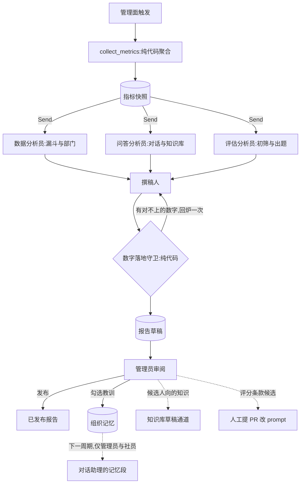

# 招新周期复盘报告

> 提案 v0.1 · 2026-11-11 · 状态:未立项。范围 = 管理面触发的离线批处理(新包 `retrospective/`)
> 与三张新表;**不改 A 模块的对话回合,不改后端,不新增后端写工具**。共同约束见
> [README](README.md)。

## 1. 背景与问题

现状(均可在代码里查到):

- 一个招新周期的数据散在两处。后端有投递、面试结果与评价;agent 自己的 Postgres 里有对话日志
  (`agent_conversation_log`)、评估任务(`evaluation_job`)、评分卡(`evaluation_scorecard`)、
  题库与选题记录(`interview_qbank`、`qbank_pick_log`)、审计(`agent_audit_log`)。
- 现成的聚合只有一个:`tools/readonly.py` 的 `get_recruit_statistics`,给管理员在对话里问「投了
  多少、各部门多少、评了多少」。它是即时查询,不留存。
- 对话日志每轮都记了工具、耗时、错误码、token 与缓存命中,但没有人按周期汇总过。
- 评估域里最该知道的一个数——**模型排的序和人最后的决定有多一致**——现在算不出来,因为没有
  地方把评分卡和采纳、驳回记录对到一起看。
- 社团每年换届。上一届调过什么、踩过什么坑、哪类问题被问爆了,靠口口相传;agent 的长期记忆
  (`agent_memory`)是按用户隔离的,人走了记忆也跟着走。

| 问题 | 表现 |
|---|---|
| 没有跨周期的基线 | 「今年比去年好」无从说起,任何改动的效果只能凭感觉 |
| 数据在,结论不在 | 三个数据域各有一堆表,没有人有时间通读 |
| 经验不过届 | 新一届管理员从零开始摸索 |
| 其他闭环没有汇合点 | 知识库缺口、评分条款候选、选用题型各自需要一个「周期结束时由人过一遍」的场合 |

## 2. 目标与非目标

**目标**

1. 每个周期留一份**指标快照**:纯代码计算,长期保留,是唯一的跨周期基线。
2. 三位分析员并行读三个数据域,撰稿人汇总成一份报告草稿;报告里的每个数字都能回到快照。
3. 报告由管理员审阅后发布;其中的「教训」经人勾选后进入**组织记忆**,下一届的管理员与社员
   在对话里能用上。
4. 给另外三份设计稿提供汇合点:知识库缺口、评分补充条款候选、题型偏好都在这份报告里过人审。

**非目标**

- 不做实时看板(那是观测系统的事),不做按人的绩效统计。
- 不给模型自由查询数据库的工具(D2)。
- 不让模型算数、不让模型下「录取标准该怎么改」的结论——它只指出现象和可能的原因。
- 报告与组织记忆对候选人不可见。

## 3. 总体流程



## 4. 关键决策

### D1 · 数字全部由代码算,模型只解读

`collect_metrics` 是一个纯函数式的聚合步骤:读后端的统计接口和 agent 自己的表,产出一份带
稳定 id 的指标字典。**与上一周期的差值也在这里算好**——「比去年多了 18%」这种话,模型拿到的是
现成的数,不是两个数让它自己减。

报告出库前过**数字落地守卫**:把叙述里出现的每一个数字抠出来,必须能在快照里找到对应的值
(或在白名单里,如年份、章节编号),对不上就把清单交回撰稿人改一次,仍对不上的句子删掉并在
草稿上标注。这是 README 里「落地校验」模式在报告上的用法。

### D2 · 三位分析员并行、互不可见;下钻只走白名单聚合

| 分析员 | 读的指标域 | 回答的问题 |
|---|---|---|
| 数据 | 漏斗、部门分布、时间分布 | 人从哪一步流失,哪个部门冷热不均 |
| 问答 | 对话量、错误率、工具使用、知识库检索信号 | 候选人在问什么,哪里没答好 |
| 评估 | 任务成败、硬零分率、人机一致、复核队列、出题与选题 | 初筛和出题靠不靠得住 |

每位分析员只拿到自己域的指标,互相看不到对方的发现——避免一个先入为主的解释把三份分析带偏。
产出是若干条**发现**,每条必须列出它依据的指标 id;列不出 id 的发现由代码丢弃。

默认是单次调用。需要下钻时(例如「驳回集中在哪个部门」),给一组**参数化的只读聚合**作为
工具:维度与过滤条件都从枚举里选,返回的仍是聚合数。不提供自由 SQL,不提供读原始行的工具。
带工具时走受限循环,预算双闸(初值 10 轮 / 120 秒)。

### D3 · 撰稿人只看发现与指标

撰稿人看不到任何原始数据,输入只有三份发现和指标快照。它的工作是去重、排优先级、写成人读的
段落,并提出**候选教训**。它不能引入新的事实——守卫会拦住新数字,而没有指标 id 支撑的断言在
prompt 里明令禁止,并由 eval 检查。

### D4 · 只报聚合,小格子抑制

- 报告里不出现任何可以指向个人的信息:没有姓名、学号、简历编号,没有用户原话——问答域只给
  **主题**和计数(主题来自知识库闭环的聚类,见[知识库运营闭环](kb-ops-loop.md))。
- 计数小于 5 的格子在快照的**展示层**显示为「<5」,分析员与撰稿人拿到的也是抑制后的值。
  「某部门只有 2 个人被驳回」这种话本身就接近点名。
- 面试官维度一律不拆:选题、采纳、驳回都只按部门和周期聚合。

### D5 · 指标快照先行,而且要长期留

快照是整份提案里唯一有时效压力的部分:对话日志、评估任务和审计记录将来都可能按保留期清理,
到那时再想补算就晚了。**周期结束时不留快照,这一届就永远没有基线。**

所以第一期只做快照,不碰模型。快照表只存聚合数,没有 PII,可以无限期保留。指标定义带版本
(`metrics_schema`),定义变了就升版本,跨版本的对比由代码拒绝而不是硬比。

### D6 · 组织记忆:报告提议,人勾选,才生效

报告末尾有一栏候选教训,每条带类别和依据的指标 id。管理员在管理面上逐条勾选、可改写,勾选的
才写入 `org_memory` 并生效。

| 类别 | 例子 |
|---|---|
| `lesson` | 「截止前三天的咨询量是平时的四倍,客服值班要提前排」 |
| `norm` | 「技术部初筛的复核队列应在两天内清完」 |
| `calendar` | 「宣讲会后一周是投递高峰」 |

与用户长期记忆的区别:

| | 用户长期记忆(已有) | 组织记忆(本提案) |
|---|---|---|
| 归属 | 一个用户 | 整个社团 |
| 写入 | 轮末自动抽取 | 报告提议 + 人勾选 |
| 可见 | 仅本人 | 管理员;标了 `member` 的对社员也可见 |
| 失效 | 用户删除 | 到期(`valid_until`)或人工退役 |

召回走对话助理现有的记忆段(`memory/recall.py` 的 `memory_section`),单独一个小标题,条数有
上限。**候选人会话永远不注入组织记忆**——由代码按会话身份拦在召回之前(与现有的
`memory_enabled_for` 同一道闸),不靠 prompt 约束。

组织记忆有保质期:默认一个周期后到期,下一份报告里会列出「去年的教训今年还成立吗」供人续期
或退役。过期的规矩比没有规矩更糟。

### D7 · 候选人向的知识不进组织记忆,走知识库草稿

复盘里发现的「候选人反复问但知识库没有」的内容,应该变成知识库条目而不是组织记忆——前者是给
候选人看的、要带出处,后者是给内部看的。报告只把这类主题列出来并指向
[知识库运营闭环](kb-ops-loop.md)的草稿通道,不自己起草。

### D8 · 对后端只读;触发与发布都在管理面

读后端只用现有的统计接口。报告草稿、发布状态、组织记忆都落在 agent 自己的表里,所以没有
对后端的写操作,不涉及 `interrupt()` 令牌;发布与勾选是管理面上的显式人工动作,各写一条审计。

后续可以给 A 模块的管理员角色加一个只读工具(按周期取已发布的报告摘要),属于工具层的常规
扩展,不在本提案的首期范围。

### D9 · 报告可重跑,带版本

同一周期可以多次生成(指标定义修了、prompt 改了),每次一个新版本,旧版本保留。发布的是某一个
具体版本;已发布的报告不可改,只能发布新版本取代。每个版本记下全部四份 prompt 的版本与指标
定义版本。

## 5. 数据面(示意)

### 指标目录(初版)

| 域 | 指标 | 来源 |
|---|---|---|
| 漏斗 | 投递总数、各决定计数、各分配部门计数、已评价人数 | 后端统计接口(`get_recruit_statistics` 同源) |
| 对话 | 轮数、会话数、渠道分布、错误率、耗时分位、工具使用分布、token 与缓存命中率 | `agent_conversation_log` |
| 知识库 | 检索次数、未命中率、低分命中率、高频主题 | `kb_query_log`(知识库闭环 P0;没有时该域降级为空并标注) |
| 初筛 | 任务数、失败率、重试分布、硬零分率、采纳与驳回(按部门)、重评次数 | `evaluation_job`、`evaluation_scorecard`、`agent_audit_log` |
| 人机一致 | 各部门池内,模型匹配分排序与人工采纳分排序的一致率;低置信卡片被改判的比例 | 评分卡 + 采纳记录(后者依赖[初筛合议](screening-panel.md)) |
| 出题 | 题库生成数、降级率、各题组类别的选用率 | `interview_qbank`、`qbank_pick_log` |
| 成本 | 各域 token 总量、单份简历平均成本 | 对话日志与评估用量日志 |

每个指标是 `{id, value, unit, n, prev, delta}`:`n` 是样本量(用于小格子抑制),`prev` 与
`delta` 来自上一周期同版本的快照,没有则为空。

### 表

```sql
CREATE TABLE IF NOT EXISTS cycle_metrics_snapshot (
    cycle_id       int         NOT NULL,
    metrics_schema text        NOT NULL,
    metrics        jsonb       NOT NULL,
    taken_at       timestamptz NOT NULL DEFAULT now(),
    PRIMARY KEY (cycle_id, metrics_schema)
);

CREATE TABLE IF NOT EXISTS cycle_retrospective (
    id              bigserial   PRIMARY KEY,
    cycle_id        int         NOT NULL,
    version         int         NOT NULL,
    status          text        NOT NULL DEFAULT 'draft'
                    CHECK (status IN ('draft', 'published', 'superseded')),
    metrics_schema  text        NOT NULL,
    sections        jsonb       NOT NULL,
    report_md       text        NOT NULL,
    unverified      jsonb       NOT NULL DEFAULT '[]',
    prompt_versions jsonb       NOT NULL,
    created_by      int         NOT NULL,
    created_at      timestamptz NOT NULL DEFAULT now(),
    published_by    int,
    published_at    timestamptz,
    UNIQUE (cycle_id, version)
);

CREATE TABLE IF NOT EXISTS org_memory (
    memory_id    bigserial   PRIMARY KEY,
    kind         text        NOT NULL CHECK (kind IN ('lesson', 'norm', 'calendar')),
    content      text        NOT NULL,
    evidence     jsonb       NOT NULL DEFAULT '{}',
    audience     text        NOT NULL DEFAULT 'admin' CHECK (audience IN ('admin', 'member')),
    status       text        NOT NULL DEFAULT 'proposed'
                 CHECK (status IN ('proposed', 'approved', 'retired')),
    source_cycle int,
    approved_by  int,
    approved_at  timestamptz,
    valid_until  timestamptz,
    embedding    vector      NOT NULL,
    embed_model  text        NOT NULL,
    created_at   timestamptz NOT NULL DEFAULT now()
);
```

`sections` 是结构化的报告(每节的发现、依据的指标 id、候选教训),`report_md` 是渲染结果;
`unverified` 记守卫删掉的句子,供审阅者知道哪里被动过。`evidence` 存报告版本与指标 id。

### 管理面接口(示意,挂在现有的 `/api/agent` 前缀下)

| 接口 | 作用 |
|---|---|
| `POST /admin/retrospective/snapshot` | 计算并保存指标快照(幂等) |
| `POST /admin/retrospective/run` | 生成一个新版本的报告草稿 |
| `GET /admin/retrospective` | 按周期取报告(草稿或已发布) |
| `POST /admin/retrospective/publish` | 发布指定版本 |
| `POST /admin/org-memory/approve`、`/retire` | 勾选或退役组织记忆 |

## 6. 角色

| 角色 | 形态 | 看得到 | 产出 | prompt |
|---|---|---|---|---|
| 数据分析员 | 单次调用,可选受限循环 | 漏斗域指标 | 发现(带指标 id) | `retrospective/data.md` |
| 问答分析员 | 同上 | 对话与知识库域指标、主题清单 | 发现 | `retrospective/qa.md` |
| 评估分析员 | 同上 | 初筛、人机一致、出题域指标 | 发现、评分条款候选 | `retrospective/evaluation.md` |
| 撰稿人 | 单次调用,无工具 | 三份发现、指标快照 | 报告各节、候选教训 | `retrospective/writer.md` |

快照计算、数字落地守卫、小格子抑制都是代码,不是角色。

## 7. 安全与失败语义

- **不可信输入**:主题清单源自候选人的提问,驳回与评分理由源自简历。进 prompt 一律包数据区;
  更根本的防线是分析员根本拿不到原话,只有主题标签和计数。
- **PII**:快照只有聚合数;报告落库前再过一遍掩码作为出口兜底。
- **权限**:触发与读取复用评估域现有的权限码,发布与勾选组织记忆要求更高一级(见开放问题)。
- **注入的最坏结果**:一条被带偏的发现或候选教训。它不会自动生效——报告要人发布,教训要人
  勾选。

| 失败点 | 语义 |
|---|---|
| 某个数据源不可用 | 该域指标缺席并在快照里标注;报告对应章节写明「数据不可用」,不整体失败 |
| 一位分析员失败(重试后仍失败) | 该章节降级为纯指标表,无解读;其余照常 |
| 撰稿人失败 | 报告降级为三份发现的直接拼接,标注「未汇总」 |
| 守卫回炉后仍有对不上的数字 | 删掉相应句子,记入 `unverified` |
| 组织记忆召回失败 | 对话照常进行,不注入(观测 fail-open) |

## 8. eval 与门禁

| suite | 性质 | 断言 |
|---|---|---|
| 指标计算单测 | 确定性 | 固定的表数据算出固定的指标;小格子被抑制;跨版本对比被拒绝 |
| 守卫单测 | 确定性 | 植入的错误数字被抓出;白名单数字放行 |
| `retro_probes`(新) | 真模型 | 合成快照里植入的异常(某部门驳回率畸高、某周错误率飙升)被相应分析员指出;每条发现都带有效的指标 id;报告不含快照之外的数字 |
| `retro_injection`(新) | 真模型 | 主题清单里植入的指令不改变报告结论,不出现在候选教训里 |
| `memory_probes`(已有,扩展) | 真模型 | 候选人会话里组织记忆不出现;管理员会话里相关的教训被用上 |

## 9. 成本与预算闸

每个周期跑一到几次,每次四次模型调用(带下钻时分析员多几轮),输入是几千 token 的指标与
发现——是四份设计稿里最便宜的一份。预算闸只有分析员下钻循环的双闸。真正的成本是人审报告的
那半小时,所以报告要短:每节至多五条发现,候选教训至多十条。

## 10. 分期

| 期 | 内容 | 验收 |
|---|---|---|
| P1 | 指标目录、`collect_metrics`、快照表与接口。**不含模型** | 本周期结束前上线并留下第一份快照 |
| P2 | 三位分析员、撰稿人、数字落地守卫、草稿与发布 | `retro_probes` 通过;管理员审过一份真实报告 |
| P3 | 组织记忆:勾选、召回、到期 | `memory_probes` 扩展用例通过;候选人会话零泄漏 |
| P4 | 与另三份设计稿汇合:知识库缺口清单、评分条款候选、题型偏好 | 各自的上游数据就位 |

## 11. 代码落位

- `retrospective/metrics.py`(新):指标目录与 `collect_metrics`,纯函数加只读查询;
  `retrospective/guard.py`:数字落地守卫与小格子抑制;`retrospective/graph.py`:扇出与汇总。
- `state/retrospective.py`(新):快照与报告两张表;`memory/org_store.py`(新):组织记忆,
  召回接到 `memory/recall.py`。
- `web/retrospective_admin.py`(新):管理面接口,在 `web/app.py` 注册。
- `prompts/retrospective/` 下四个文件,以及对应的 eval 执行器与数据集。

## 12. 开放问题

1. 周期的起止时间从哪里来:对话日志没有周期字段,只能按时间窗切,需要后端给出周期的起止日期。
2. 人机一致率用哪个人工信号:采纳时填的分数、最终录取决定,还是面试评价——三者含义不同
   (与[初筛合议](screening-panel.md)的开放问题相同,应一起定)。
3. 权限码:发布报告与勾选组织记忆是复用现有的还是新增一个,要和后端的权限表一起定。
4. 组织记忆对社员可见的范围:哪些类别可以标 `member`,由谁决定。
5. 快照要不要在周期进行中定期打点(每周一份),以便看趋势而不只是终值。
6. 守卫对「约三成」「翻了一倍」这类非数字表述无能为力,是否需要在 prompt 里禁用模糊量词。
