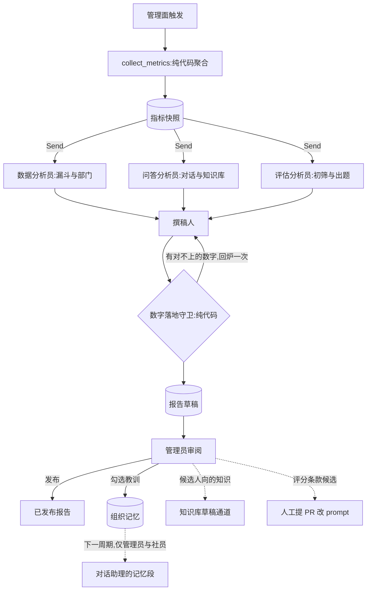

# 招新周期复盘报告

> 提案 v0.1 · 2026-11-11 · 状态:**P1 已实现**(指标快照);**P2 已实现、验收未完成**(分析员、
> 撰稿人、数字落地守卫、草稿与发布的机制与测试都在,但 eval 没跑过真模型、也还没有管理员审过
> 一份真实报告,见 §10 进度);P3–P4 是设计稿,没有实现。范围 = 管理面触发的离线批处理(新包
> `retrospective/`)与三张新表;**不改 A 模块的对话回合,不改后端,不新增后端写工具**。
> 共同约束见 [README](README.md)。

## 1. 背景与问题

现状(均可在代码里查到):

- 一个招新周期的数据散在两处。后端有投递、面试结果与评价;agent 自己的 Postgres 里有对话日志
  (`agent_conversation_log`)、评估任务(`evaluation_job`)、评分卡(`evaluation_scorecard`)、
  题库与选题记录(`interview_qbank`、`qbank_pick_log`)、审计(`agent_audit_log`)。
- 现成的聚合只有一个:`tools/readonly.py` 的 `get_recruit_statistics`,给管理员在对话里问「投了
  多少、各部门多少、评了多少」。它是即时查询,不留存。
- 对话日志每轮都记了工具、耗时、错误码、token 与缓存命中,但没有人按周期汇总过。
- 评估域里最该知道的一个数——**模型排的序和人最后的决定有多一致**——现在算不出来,因为没有
  地方把评分卡和采纳、驳回记录对到一起看。
- 社团每年换届。上一届调过什么、踩过什么坑、哪类问题被问爆了,靠口口相传;agent 的长期记忆
  (`agent_memory`)是按用户隔离的,人走了记忆也跟着走。

| 问题 | 表现 |
|---|---|
| 没有跨周期的基线 | 「今年比去年好」无从说起,任何改动的效果只能凭感觉 |
| 数据在,结论不在 | 三个数据域各有一堆表,没有人有时间通读 |
| 经验不过届 | 新一届管理员从零开始摸索 |
| 其他闭环没有汇合点 | 知识库缺口、评分条款候选、选用题型各自需要一个「周期结束时由人过一遍」的场合 |

## 2. 目标与非目标

**目标**

1. 每个周期留一份**指标快照**:纯代码计算,长期保留,是唯一的跨周期基线。
2. 三位分析员并行读三个数据域,撰稿人汇总成一份报告草稿;报告里的每个数字都能回到快照。
3. 报告由管理员审阅后发布;其中的「教训」经人勾选后进入**组织记忆**,下一届的管理员与社员
   在对话里能用上。
4. 给另外三份设计稿提供汇合点:知识库缺口、评分补充条款候选、题型偏好都在这份报告里过人审。

**非目标**

- 不做实时看板(那是观测系统的事),不做按人的绩效统计。
- 不给模型自由查询数据库的工具(D2)。
- 不让模型算数、不让模型下「录取标准该怎么改」的结论——它只指出现象和可能的原因。
- 报告与组织记忆对候选人不可见。

## 3. 总体流程



## 4. 关键决策

### D1 · 数字全部由代码算,模型只解读

`collect_metrics` 是一个纯函数式的聚合步骤:读后端的统计接口和 agent 自己的表,产出一份带
稳定 id 的指标字典。**与上一周期的差值也由代码算好**——「比去年多了 18%」这种话,模型拿到的是
现成的数,不是两个数让它自己减。

差值不落库,读取时现算(`retrospective/compare.py`):快照只记本周期的事实,同一份快照可以对着
不同的基线读,基线周期重新采集后也不会留下过期的差值。哪个周期算「上一周期」由调用方指定——
周期 id 和日期都说明不了(测试周期、一年多次招新)。任一侧被抑制的指标不出差值,否则被抑制的
数可以反推。

报告出库前过**数字落地守卫**:把叙述里出现的每一个数字抠出来,必须能在快照里找到对应的值
(或在白名单里,如年份、章节编号),对不上就把清单交回撰稿人改一次,仍对不上的句子删掉并在
草稿上标注。这是 README 里「落地校验」模式在报告上的用法。

守卫落地时的几条取舍(`retrospective/grounding.py`):

- **比对的是这句话引用的指标,不是整份快照**。快照里有几百个数,编出来的数很容易碰巧和某个
  不相干的指标相等;所以每段文字都要带 `metric_ids`,数字只和这几个指标的值、样本量、基线值、
  差值比。
- **约数按写出的精度核对**:「963 万」对得上 9,634,112,「960 万」对不上;「25.3%」对得上
  0.2534,「25.6%」对不上。不带单位的整数必须一字不差。比率的差只认「个百分点」——写成百分比
  分不清是相对变化还是百分点差。
- **守卫看不懂的量一律按对不上处理**:「三成」「翻倍」「过半」这类模糊量词,以及「两人」「三名」
  这类中文数字的人数(后者正是小格子换个写法)。prompt 里也明令不用。这部分是启发式的,宁可
  多删一句无害的话(开放问题 6 就此定下)。
- 白名单只有:时间窗的首尾两天、带「年 / 届」的年份、本周期与基线周期的编号、分位数标记、
  列表序号、「不足 5」这类抑制用语,以及采集参数。
- 分析员的发现也过同一个守卫:数字对不上的发现直接丢掉,不进撰稿人的视野。

### D2 · 三位分析员并行、互不可见;下钻只走白名单聚合

| 分析员 | 读的指标域 | 回答的问题 |
|---|---|---|
| 数据 | 漏斗、部门分布、时间分布 | 人从哪一步流失,哪个部门冷热不均 |
| 问答 | 对话量、错误率、工具使用、知识库检索信号 | 候选人在问什么,哪里没答好 |
| 评估 | 任务成败、硬零分率、人机一致、复核队列、出题与选题 | 初筛和出题靠不靠得住 |

每位分析员只拿到自己域的指标,互相看不到对方的发现——避免一个先入为主的解释把三份分析带偏。
产出是若干条**发现**,每条必须列出它依据的指标 id;列不出 id 的发现由代码丢弃。

默认是单次调用。需要下钻时(例如「驳回集中在哪个部门」),给一组**参数化的只读聚合**作为
工具:维度与过滤条件都从枚举里选,返回的仍是聚合数。不提供自由 SQL,不提供读原始行的工具。
带工具时走受限循环,预算双闸(初值 10 轮 / 120 秒)。

已实现的是单次调用;**下钻工具没有做**——快照已经按部门、渠道、题组类别拆好,先看真实报告里
分析员是不是真的缺维度再决定。实现上的几点(`retrospective/views.py`、`roles.py`):

- 视图按角色裁好再进 prompt:数据分析员只有漏斗域,问答分析员是对话域、知识库域加对话的 token
  总量,评估分析员是初筛、人机一致、出题三个域加评估的 token。每个指标值恰好归一位。
- 某位分析员的域都没有数据时不调用模型,那一节直接标「数据不可用」。
- 模型交回的每条发现逐条过闸门,不合格的丢弃并留痕,不连累别的条:依据(`metric_ids` 非空且都
  在这位分析员看得到的指标里)、数字(上面的守卫)、文字(不含个人信息、不像指令、不超长)。
- 评估分析员另外可以提**评分条款候选**,过同样的闸门,随报告留给人看(P4 的汇合点)。

### D3 · 撰稿人只看发现与指标

撰稿人看不到任何原始数据,输入只有三份发现和指标快照。它的工作是去重、排优先级、写成人读的
段落,并提出**候选教训**。它不能引入新的事实——守卫会拦住新数字,而没有指标 id 支撑的断言在
prompt 里明令禁止,并由 eval 检查。

实现上再加三道代码约束:每一节只能引用这一节的指标(跨域的综合放在总述和教训里);分析员
没有产出的那一节,撰稿人写了也不收;撰稿人漏写某一节、或写的全被守卫删掉时,该节退回分析员的
发现——分析员指出的现象不能在汇总这一步悄悄丢掉。分析员过闸门后的原始发现随报告留底
(`sections[].findings`),审阅的人可以对照撰稿人改写了什么。撰稿人至多写两轮:第一稿,以及
数字对不上时的一次回炉。

### D4 · 只报聚合,小格子抑制

- 报告里不出现任何可以指向个人的信息:没有姓名、学号、简历编号,没有用户原话——问答域只给
  **主题**和计数(主题来自知识库闭环的聚类,见[知识库运营闭环](kb-ops-loop.md))。
- 计数小于 5 的格子显示为「<5」,分析员与撰稿人拿到的也是抑制后的值。
  「某部门只有 2 个人被驳回」这种话本身就接近点名。
- 面试官维度一律不拆:选题、采纳、驳回都只按部门和周期聚合。

抑制发生在**采集时、落库之前**(`retrospective/guard.py`),不是只在展示层。快照要无限期保留,
表里就不该有小格子;存下来的已经是抑制后的值,之后任何读取方都绕不过去。代价是小格子的精确值
不留存——原料还在的时候可以改规则后重新采集(落新版本)。规则:

| 对象 | 抑制条件 | 为什么 |
|---|---|---|
| 计数 | 小于 5,**0 也算** | 设计稿原文「小于 5」的字面含义 |
| 比率 | 分子、补集(分母 − 分子)、分母任一小于 5;被抑制时带 `side`(`low` / `high`) | 只看分母不够:「30 人里 6.7%」能反推出恰好 2 人。`side` 让读的人分得清是接近 0 还是接近 1,否则「错误率被抑制」读不出好坏 |
| 分位数、合计、均值 | 样本量小于 5 | — |
| 分布 | 逐格按计数规则;恰好只有一格被抑制时,连带抑制剩下最小的一格 | 只藏一格可以用合计减出来 |
| 分布里的 0 · 判定结果 | 通过/不通过、采纳/驳回、各部门的格子**固定出**,缺席按 0 补,0 照样被抑制 | 不出格子就是明说 0;「某部门 0 人被采纳」加上「被驳回的不足 5 人」等于说这个部门看过的人全被驳回了 |
| 分布里的 0 · 流程状态 | 待定、待调剂、未决、未分配、未填志愿为 0 时**不出格子** | 「没有人还在待定」不指向任何人;硬要抑制,连带规则会把旁边的通过数、驳回数藏掉,而周期收尾时这些桶恰恰都是 0 |
| 分布的键 | 只放行 ASCII 标识符形状的短键,中文键必须在白名单(部门名)里,其余并入 `other` | 键里的文字和数字一样会进快照 |

不防跨指标的联合推断(两个不同的分布交叉相减、两个合计相减);目录因此不发布「部门 × 决定」
的行合计,不给最要紧的那种减法留材料。

### D5 · 指标快照先行,而且要长期留

快照是整份提案里唯一有时效压力的部分:对话日志、评估任务和审计记录将来都可能按保留期清理,
到那时再想补算就晚了。**周期结束时不留快照,这一届就永远没有基线。**

所以第一期只做快照,不碰模型。快照表只存聚合数,没有 PII,可以无限期保留。指标定义带版本
(`metrics_schema`),定义变了就升版本,跨版本的对比由代码拒绝而不是硬比。

快照表只追加:同一周期可以重复采集,版本号按周期递增、旧版本保留;算出来的内容与最新一版相同
就不落新版本(重复触发是幂等的)。表里没有 `thread_id`,不挂在会话删除与保留期清理的任何路径
上。快照正文带着当时的指标目录(名字与口径),多年后读快照的人不必翻代码找口径。

### D6 · 组织记忆:报告提议,人勾选,才生效

报告末尾有一栏候选教训,每条带类别和依据的指标 id。管理员在管理面上逐条勾选、可改写,勾选的
才写入 `org_memory` 并生效。

| 类别 | 例子 |
|---|---|
| `lesson` | 「截止前三天的咨询量是平时的四倍,客服值班要提前排」 |
| `norm` | 「技术部初筛的复核队列应在两天内清完」 |
| `calendar` | 「宣讲会后一周是投递高峰」 |

与用户长期记忆的区别:

| | 用户长期记忆(已有) | 组织记忆(本提案) |
|---|---|---|
| 归属 | 一个用户 | 整个社团 |
| 写入 | 轮末自动抽取 | 报告提议 + 人勾选 |
| 可见 | 仅本人 | 管理员;标了 `member` 的对社员也可见 |
| 失效 | 用户删除 | 到期(`valid_until`)或人工退役 |

召回走对话助理现有的记忆段(`memory/recall.py` 的 `memory_section`),单独一个小标题,条数有
上限。**候选人会话永远不注入组织记忆**——由代码按会话身份拦在召回之前(与现有的
`memory_enabled_for` 同一道闸),不靠 prompt 约束。

组织记忆有保质期:默认一个周期后到期,下一份报告里会列出「去年的教训今年还成立吗」供人续期
或退役。过期的规矩比没有规矩更糟。

### D7 · 候选人向的知识不进组织记忆,走知识库草稿

复盘里发现的「候选人反复问但知识库没有」的内容,应该变成知识库条目而不是组织记忆——前者是给
候选人看的、要带出处,后者是给内部看的。报告只把这类主题列出来并指向
[知识库运营闭环](kb-ops-loop.md)的草稿通道,不自己起草。

### D8 · 对后端只读;触发与发布都在管理面

读后端只用现有的统计接口,外加按 id 取周期的接口(拿起止日期)。用服务账号读,不用触发人的
令牌:快照是基线,内容不该随触发人的后端权限而变。报告草稿、发布状态、组织记忆都落在 agent
自己的表里,所以没有对后端的写操作,不涉及 `interrupt()` 令牌;发布与勾选是管理面上的显式
人工动作,各写一条审计。采集快照不是人工决策,不写审计行——谁在什么时候采的记在快照行上
(`taken_by` / `taken_at`)。

后续可以给 A 模块的管理员角色加一个只读工具(按周期取已发布的报告摘要),属于工具层的常规
扩展,不在本提案的首期范围。

### D9 · 报告可重跑,带版本

同一周期可以多次生成(指标定义修了、prompt 改了),每次一个新版本,旧版本保留。发布的是某一个
具体版本;已发布的报告不可改,只能发布新版本取代。每个版本记下全部四份 prompt 的版本与指标
定义版本。

生成要调四次模型,耗时以分钟计,所以是后台任务,报告因此多出两个状态:

```
generating ──→ draft ──→ published ──→ superseded
     └──→ failed
```

接口先占一个版本(`generating`)就返回,模型跑完填正文转 `draft`,失败转 `failed` 并留原因。
同一周期同时只允许一份在生成;停在 `generating` 超过 15 分钟的版本(进程在生成途中退出)在下次
生成或读取时被判为失败,迟到的结果不再写入。只有 `draft` 能发布,同一周期同时只有一份 `published`
(应用层按周期加锁,数据库再用部分唯一索引兜底)。正文写入后不再改——没有改写草稿的接口,要改
就重新生成一版。每个版本还记下它依据的快照版本、对比的基线周期与模型名。

## 5. 数据面

快照部分(指标目录、`cycle_metrics_snapshot`、三个快照接口)是已实现的形态;报告与组织记忆的表
和接口仍是示意。

### 指标目录(`cycle_metrics/v1`)

目录在 `retrospective/catalog.py` 的 `CATALOG`,每项有稳定 id、名字和口径说明;算法在
`retrospective/metrics.py` 的各域函数里。

| 域 | 指标 | 来源 |
|---|---|---|
| 漏斗 `funnel` | 投递总数、面试结果条数、各决定计数、各分配部门计数(键是后端部门 id,另有未分配一格)、已评价人数 | 后端统计(`tools/readonly.get_recruit_statistics` 同源) |
| 对话 `conversation` | 轮数、会话数、渠道分布、错误率、单轮耗时 P50/P90/P99、工具调用次数分布、输入与输出 token、缓存命中率 | `agent_conversation_log`,按周期时间窗切,不含评估任务的用量行 |
| 知识库 `kb` | 检索次数、未命中率、不可用率、低分命中率 | `kb_query_log`,按周期时间窗切 |
| 初筛 `screening` | 任务数、任务失败率、重试分布(按执行次数)、已出卡简历数、硬零分率、重评次数、采纳/驳回/未决、采纳与驳回(按第一志愿部门) | `evaluation_job`、`evaluation_scorecard` |
| 出题 `qbank` | 题库生成数、降级率、有选题记录的简历数、各题组类别的选用率 | `interview_qbank`、`qbank_pick_log` |
| 成本 `cost` | 对话域 token 总量、评估域 token 总量(题库段)、单份简历平均 token(题库段) | 对话日志;评估任务的用量行按 `eval:<job_id>` 关联回 job 得到周期 |

落地时定下来的口径(每条的完整说明在目录里):

- **周期时间窗**:对话日志与检索日志没有周期字段。取后端 `GET /api/cycles/{cycleId}` 的
  `startDate`~`endDate`,按北京时间切成 `[开始日 0 点, 结束日次日 0 点)`。两个周期的日期重叠时,
  重叠期的对话与检索会同时计入两边。
- **对话域与知识库域只数采集时还在的行**:用户删掉的会话、过期清理掉的会话不在其中——这正是
  快照要趁早留的原因。
- **低分命中率**:命中的检索里,最高向量分低于向量门槛(采集时的 `kb_min_score`,随快照存在
  `params` 里)的比例,即只靠关键词门槛过关的命中。
- **任务失败率**:当前状态为失败的任务 ÷ 全部任务;失败后重试成功的不算。
- **采纳与驳回**:取每份简历**历史上最后一次**人工决定,与评审队列的 `decided_status` 同口径,
  复评写出的新 draft 卡不抹掉它。数据取自评分卡的状态,没有用 `agent_audit_log`——卡态就是权威,
  审计行里同一次决定可能有重复提交。
- **降级率**:每份简历最新一版题库里,任一仓库题组带 `qbank_v2.degraded` 标记的比例。
- **选用率**:只看有选题记录的简历;分子分母都从这些简历最新一版题库展开,选在旧版本上、
  与新题对不上的记录不计。
- **成本只报 token**:仓库里没有计价表,不折算金额。

暂缺的指标(留在目录里并标了原因,快照不产出值):

| 指标 | 原因 |
|---|---|
| 知识库 · 高频主题 | 主题来自[知识库运营闭环](kb-ops-loop.md) P1 的聚类,尚未实现;检索日志里的问题原文不能进快照 |
| 人机一致 · 排序一致率 | 人工信号用哪一个还没定(开放问题 2) |
| 人机一致 · 低置信卡片改判率 | 评分卡没有置信度字段,该字段由[初筛合议](screening-panel.md)提出,尚未实现 |
| 成本 · 评估域 token 总量(评分段) | 评分段的用量只打在日志行里,没有落库,事后数不出来 |

快照里每个值是 `{id, metric, key, value, unit, n, suppressed, side}`:标量的 `id` 就是指标 id,
分布的一格是 `指标id[键]`;`n` 是样本量(计数的 `n` 是它自己,比率的 `n` 是分母);被抑制时 `value`
为空、`suppressed` 为真,`side` 说明是哪一头小(`low` 展示为「<5」)。带基线读取时每个值多出 `prev`、`delta`、`delta_ratio`(比率类只给百分点差)。
目录里有、但这次采集后端没给出来的数(例如该周期没开评价表)列在快照的 `absent` 里,不写成 0。

### 表

```sql
-- 已实现(state/retrospective/snapshot_store.py),只追加
CREATE TABLE IF NOT EXISTS cycle_metrics_snapshot (
    id             bigserial   PRIMARY KEY,
    cycle_id       int         NOT NULL,
    version        int         NOT NULL,   -- 按周期递增
    metrics_schema text        NOT NULL,
    metrics        jsonb       NOT NULL,   -- 快照正文,含目录、各域采集状态、指标值
    content_hash   text        NOT NULL,   -- 正文指纹:与最新一版相同就不落新版本
    taken_by       int         NOT NULL,
    taken_at       timestamptz NOT NULL DEFAULT now(),
    UNIQUE (cycle_id, version)
);

-- 已实现(state/retrospective/report_store.py)
CREATE TABLE IF NOT EXISTS cycle_retrospective (
    id                        bigserial   PRIMARY KEY,
    cycle_id                  int         NOT NULL,
    version                   int         NOT NULL,   -- 按周期递增
    status                    text        NOT NULL DEFAULT 'generating'
        CHECK (status IN ('generating', 'draft', 'failed', 'published', 'superseded')),
    metrics_schema            text        NOT NULL,
    snapshot_version          int         NOT NULL,   -- 依据的快照版本
    baseline_cycle_id         int,                    -- 对比的基线周期(可空)
    baseline_snapshot_version int,
    sections                  jsonb       NOT NULL DEFAULT '{}',
    report_md                 text        NOT NULL DEFAULT '',
    unverified                jsonb       NOT NULL DEFAULT '[]',
    prompt_versions           jsonb       NOT NULL DEFAULT '{}',
    usage                     jsonb       NOT NULL DEFAULT '{}',   -- 本次生成的 token 用量
    error                     text,                   -- failed 时的原因摘要
    created_by                int         NOT NULL,
    created_at                timestamptz NOT NULL DEFAULT now(),
    finished_at               timestamptz,
    published_by              int,
    published_at              timestamptz,
    UNIQUE (cycle_id, version)
);
-- 同一周期至多一份已发布、至多一份在生成
CREATE UNIQUE INDEX … ON cycle_retrospective (cycle_id) WHERE status = 'published';
CREATE UNIQUE INDEX … ON cycle_retrospective (cycle_id) WHERE status = 'generating';

-- 以下是示意(P3)

CREATE TABLE IF NOT EXISTS org_memory (
    memory_id    bigserial   PRIMARY KEY,
    kind         text        NOT NULL CHECK (kind IN ('lesson', 'norm', 'calendar')),
    content      text        NOT NULL,
    evidence     jsonb       NOT NULL DEFAULT '{}',
    audience     text        NOT NULL DEFAULT 'admin' CHECK (audience IN ('admin', 'member')),
    status       text        NOT NULL DEFAULT 'proposed'
                 CHECK (status IN ('proposed', 'approved', 'retired')),
    source_cycle int,
    approved_by  int,
    approved_at  timestamptz,
    valid_until  timestamptz,
    embedding    vector      NOT NULL,
    embed_model  text        NOT NULL,
    created_at   timestamptz NOT NULL DEFAULT now()
);
```

`sections` 是结构化的报告(每节的发现、依据的指标 id、候选教训),`report_md` 是渲染结果;
`unverified` 记守卫删掉的句子和闸门丢掉的条目,供审阅者知道哪里被动过。`evidence` 存报告版本与
指标 id。

`report_md` 里只有段落、总述、教训是模型写的;标题、每段的依据标注、每节的指标表都由代码从
快照生成(`retrospective/render.py`),表里的数不经过模型。

### 管理面接口(挂在现有的 `/api/agent` 前缀下)

已实现(`web/retrospective_admin.py`):

| 接口 | 作用 | 权限 |
|---|---|---|
| `POST /admin/retrospective/snapshot` | 采集并保存指标快照;内容与最新一版相同则不落新版本,返回 `created: false` | `evaluation:run` |
| `GET /admin/retrospective/snapshot` | 读最新一版或指定 `version`;带 `baseline_cycle_id` 时附差值,指标定义版本不同返回 409 | `resume:audit` 或 `evaluation:run` |
| `GET /admin/retrospective/snapshots` | 一个周期的版本列表与各域采集状态,不含正文 | 同上 |

#### 快照接口契约(给管理面前端)

三个接口都要 `Authorization: Bearer <官网 JWT>`;没带或无效 401,权限码不够 403(`detail` 写明所需
权限码)。出错时响应体是 `{"detail": "<文案>"}`,文案可以直接展示;唯一的例外是 422(参数缺失或
不合法),那时 `detail` 是框架给的校验错误列表,不适合直接展示。

**`POST /admin/retrospective/snapshot`** — 请求体 `{"cycle_id": <整数,≥1>}`。

| 状态码 | 含义 |
|---|---|
| 200 | 采集完成。响应是下面的「快照响应」再加 `created`:`true` 落了新版本,`false` 内容与最新一版相同、返回的是已有那一版 |
| 404 | 后端查不到这个周期,没有采集 |
| 422 | `cycle_id` 缺失或不合法 |
| 500 | 采集或保存失败,可重试 |

200 不代表每个域都采到了:要看 `snapshot.domains`,有 `unavailable` 就提示管理员稍后重新触发。

**`GET /admin/retrospective/snapshot`** — 查询参数 `cycle_id`(必填)、`version`(可选,不给取最新
一版)、`baseline_cycle_id`(可选,对着该周期最新的同版本快照算差值)。

| 状态码 | 含义 |
|---|---|
| 200 | 「快照响应」。带基线时 `snapshot.metrics` 每项多出 `prev`、`delta`、`delta_ratio`,`snapshot` 多出 `baseline: {cycle_id, schema}` |
| 400 | 基线周期与本周期相同 |
| 404 | 该周期还没有快照 / 指定版本不存在 / 基线周期还没有快照(看 `detail` 区分) |
| 409 | 基线周期没有同一版指标定义的快照,不能对比 |

**`GET /admin/retrospective/snapshots`** — 查询参数 `cycle_id`(必填)。200 返回
`{"items": [...], "total": <整数>}`,新版本在前;每项是
`{cycle_id, version, metrics_schema, content_hash, taken_by, taken_at, domains}`,没有指标正文。

**快照响应**

| 字段 | 说明 |
|---|---|
| `cycle_id`、`version` | 周期与版本号(版本按周期从 1 递增) |
| `metrics_schema` | 指标定义版本,如 `cycle_metrics/v1` |
| `taken_by`、`taken_at` | 采集人的用户 id、采集时间(ISO 8601,带时区) |
| `snapshot` | 快照正文,见下表 |

| `snapshot` 的字段 | 说明 |
|---|---|
| `schema`、`cycle_id` | 同上层的 `metrics_schema` 与 `cycle_id` |
| `window` | `{start, end, timezone}`,对话与知识库两个域统计的时间窗(半开区间);取不到周期日期时为 `null` |
| `small_cell_min` | 小格子阈值(5) |
| `params` | 采集时用到的配置,目前只有 `kb_min_score` |
| `domains` | 域名 → `{status, reason?}`。`status`:`ok` 采到了;`unavailable` 这次数据源不可用(带 `reason`);`pending` 该域指标都还算不出来 |
| `catalog` | 指标目录,每项 `{id, domain, name, definition, unit, status, reason}`。`name` 与 `definition` 用来做表头和口径提示;`status` 为 `pending` 的是暂缺指标,`reason` 是原因 |
| `metrics` | 指标值,每项 `{id, metric, key, value, unit, n, suppressed, side}`,见下 |
| `absent` | 目录里有、这次没取到值的指标,每项 `{id, reason}` |

`metrics` 每一项的读法:

- `metric` 是它所属的目录项 id,用它去 `catalog` 里找名字和口径。`key` 为空是标量;`key` 非空是
  分布里的一格(同一个 `metric` 的多项合起来是一张小表),`key` 是部门名、部门 id、渠道名这类标识,
  `other` 表示并入「其他」的格子。
- `unit`:`count` 计数、`ratio` 比率(0–1 的小数,展示时转百分比)、`ms` 毫秒、`tokens`。
- `n` 是样本量(比率的分母);可能为 `null`。
- `suppressed` 为真时 `value` 为 `null`,不要显示成 0:`side` 是 `low` 显示「<5」(比率显示「不足 5 / n」),
  `high` 只出现在比率上、显示「接近 100%」,`side` 为 `null` 显示「样本不足」。
- 带基线时:`prev` 是基线周期的值,`delta` 是差值(比率是百分点差,即两个小数相减),`delta_ratio`
  是相对变化(比率类不给)。三者都可能为 `null`——任一侧没有值或被抑制时不出差值。

报告接口(已实现,同在 `web/retrospective_admin.py`):

| 接口 | 作用 | 权限 |
|---|---|---|
| `POST /admin/retrospective/run` | 先采一次快照,再后台生成一版报告草稿;立即返回占到的版本号 | `evaluation:run` |
| `GET /admin/retrospective/report` | 读最新一版或指定 `version` 的报告 | `evaluation:run` 看全部版本;只有 `resume:audit` 的只看得到已发布的 |
| `GET /admin/retrospective/reports` | 一个周期的报告版本列表,不含正文 | 同上 |
| `POST /admin/retrospective/publish` | 发布一个草稿版本,原先已发布的转 `superseded`;先写审计再发布 | `evaluation:run` |

读报告的路径用了 `/report` 与 `/reports`,与快照的 `/snapshot`、`/snapshots` 对齐(示意里写的是
`GET /admin/retrospective`)。

#### 报告接口契约(给管理面前端)

鉴权与出错时的响应体同快照接口。

**`POST /admin/retrospective/run`** — 请求体 `{"cycle_id": <整数,≥1>, "baseline_cycle_id": <整数,可选>}`。
给了 `baseline_cycle_id`,报告里会写相对那个周期的变化。

| 状态码 | 含义 |
|---|---|
| 202 | 已开始生成。响应 `{cycle_id, version, status: "generating", snapshot_version, baseline_cycle_id}`。之后轮询 `GET …/report?cycle_id=&version=`,直到 `status` 变成 `draft` 或 `failed`;预计几分钟(单次模型调用上限 180 秒,超过 15 分钟仍在生成的版本会被判为失败) |
| 400 | 基线周期与本周期相同 |
| 404 | 后端查不到这个周期,或基线周期还没有快照 |
| 409 | 该周期已有一份报告在生成,或基线周期没有同一版指标定义的快照 |
| 500 | 采集快照或创建报告失败,可重试 |
| 503 | 报告生成没有开启(见 §10 进度里的开关);`detail` 里写了怎么打开。前端应当把它当成「功能未开放」,不是故障 |

**`GET /admin/retrospective/report`** — 查询参数 `cycle_id`(必填)、`version`(可选,不给取最新一版)。
没有 `evaluation:run` 的人只在已发布的版本里找;找不到一律 404(看 `detail`)。200 返回:

| 字段 | 说明 |
|---|---|
| `cycle_id`、`version`、`status` | `status` 五选一:`generating` / `draft` / `failed` / `published` / `superseded` |
| `metrics_schema`、`snapshot_version` | 依据的指标定义版本与快照版本(用它去取快照画指标表) |
| `baseline_cycle_id`、`baseline_snapshot_version` | 对比的基线;没有则为 `null` |
| `sections` | 结构化正文,见下表;`generating` 与 `failed` 时是空对象 |
| `report_md` | 渲染好的 Markdown 全文,可直接展示 |
| `unverified` | 没有进入报告的内容,每项 `{where, text, reason}`;审阅时应当展示出来 |
| `prompt_versions` | 四份 prompt 的版本、`metrics_schema`、`model` |
| `usage` | `{input_tokens, output_tokens}` |
| `error` | `failed` 时的原因摘要,否则 `null` |
| `created_by`、`created_at`、`finished_at`、`published_by`、`published_at` | 用户 id 与时间(ISO 8601);未发生的为 `null` |

| `sections` 的字段 | 说明 |
|---|---|
| `summary` | `{text, metric_ids}` 或 `null` |
| `sections` | 固定三项,按 `data` / `qa` / `evaluation` 的顺序。每项 `{role, title, status, items, findings}`:`status` 为 `ok`、`analyst_failed`(分析员没有产出,只展示指标表)或 `no_data`(这一节的数据不可用);`items` 是报告里这一节的段落,`findings` 是分析员的原始发现,两者每项都是 `{text, metric_ids}` |
| `lessons` | 候选教训,每项 `{kind, content, metric_ids}`,`kind` 为 `lesson` / `norm` / `calendar`。只是候选,勾选生效是 P3 的事 |
| `rubric_candidates` | 评分条款候选,每项 `{text, metric_ids}` |
| `writer_status` | `ok`;`failed`(撰稿人没有产出,各节直接列分析员的发现,应提示「未汇总」);`skipped`(没有任何发现可写) |

`metric_ids` 里是快照 `metrics` 的 `id`,或 `catalog` 的目录项 `id`(表示引用它名下的每一格)。

**`GET /admin/retrospective/reports`** — 查询参数 `cycle_id`。200 返回 `{"items": [...], "total": <整数>}`,
新版本在前;每项是报告响应去掉 `sections`、`report_md`、`unverified`、`prompt_versions`、`usage`、
`baseline_snapshot_version` 之后剩下的字段。

**`POST /admin/retrospective/publish`** — 请求体 `{"cycle_id": <整数>, "version": <整数>}`。

| 状态码 | 含义 |
|---|---|
| 200 | 已发布。响应 `{cycle_id, version, status: "published", published_by, published_at}` |
| 404 | 没有这个版本 |
| 409 | 该版本不是草稿(还在生成、生成失败、已发布或已被取代) |
| 503 | 审计写入失败,报告**没有**发布,可重试 |

示意(P3 起):

| 接口 | 作用 |
|---|---|
| `POST /admin/org-memory/approve`、`/retire` | 勾选或退役组织记忆 |

## 6. 角色

| 角色 | 形态 | 看得到 | 产出 | prompt |
|---|---|---|---|---|
| 数据分析员 | 单次调用,可选受限循环 | 漏斗域指标 | 发现(带指标 id) | `retrospective/data.md` |
| 问答分析员 | 同上 | 对话与知识库域指标、主题清单 | 发现 | `retrospective/qa.md` |
| 评估分析员 | 同上 | 初筛、人机一致、出题域指标 | 发现、评分条款候选 | `retrospective/evaluation.md` |
| 撰稿人 | 单次调用,无工具 | 三份发现、指标快照 | 报告各节、候选教训 | `retrospective/writer.md` |

快照计算、数字落地守卫、小格子抑制都是代码,不是角色。

四份 prompt 都已在 `prompts/retrospective/` 下(`*/v1`,模型档 strong)。已实现的形态里三位
分析员都是单次调用、没有工具;问答分析员还拿不到主题清单(知识库闭环的聚类未实现)。

## 7. 安全与失败语义

- **不可信输入**:主题清单源自候选人的提问,驳回与评分理由源自简历。进 prompt 一律包数据区;
  更根本的防线是分析员根本拿不到原话,只有主题标签和计数。
- **PII**:快照只有聚合数;报告落库前再过一遍掩码作为出口兜底。模型写的文字里,数字由落地守卫
  管(手机号、学号在引用的指标里对不上),不带数字也认得出的个人信息(邮箱)由文字闸门拦;被
  丢弃的原文记进 `unverified` 之前同样脱敏。
- **权限**:触发与读取复用评估域现有的权限码——触发快照采集要 `evaluation:run`(执行权),读取要
  `resume:audit`(查看权,持执行权的人也能读);发布与勾选组织记忆要求更高一级(见开放问题)。
  报告这边:生成、看草稿、发布都要 `evaluation:run`;只有 `resume:audit` 的人只看得到**已发布**
  的版本——草稿是没人审过的模型产出。「更高一级」的权限码后端现在没有,发布暂时与生成同级。
- **发布是人工决策**:先写审计(`op=publish_retrospective`),审计写不进去就不发布。它只写 agent
  自己的表,不经确认令牌——点「发布」的那个人就是确认。
- **注入的最坏结果**:一条被带偏的发现或候选教训。它不会自动生效——报告要人发布,教训要人
  勾选。

| 失败点 | 语义 |
|---|---|
| 某个数据源不可用 | 该域指标缺席并在快照里标注(`domains` 里 `unavailable` + 原因,只给类别不给异常原文);报告对应章节写明「数据不可用」,不整体失败。数据源恢复后重新采集,落新版本 |
| 后端查不到这个周期 | 整体拒绝(404),不落空快照 |
| 一位分析员失败(输出两次不合规、超时、模型报错) | 该章节降级为纯指标表,无解读;其余照常 |
| 撰稿人失败 | 报告降级为三份发现的直接拼接,标注「未汇总」 |
| 守卫回炉后仍有对不上的数字 | 删掉相应句子,记入 `unverified` |
| 撰稿人回炉那一轮失败 | 沿用第一稿,对不上的句子照删 |
| 生成任务本身出错,或进程在生成途中退出 | 该版本转 `failed` 并留原因(后者在下次生成时按超时清理);不影响已有的草稿与已发布版本 |
| 组织记忆召回失败 | 对话照常进行,不注入(观测 fail-open) |

## 8. eval 与门禁

| suite | 性质 | 断言 |
|---|---|---|
| 指标计算单测 | 确定性 | 固定的表数据算出固定的指标;小格子被抑制;跨版本对比被拒绝 |
| 守卫单测 | 确定性 | 植入的错误数字被抓出;白名单数字放行 |
| `retro_probes`(新) | 真模型 | 合成快照里植入的异常(某部门驳回率畸高、某周错误率飙升)被相应分析员指出;每条发现都带有效的指标 id;报告不含快照之外的数字 |
| `retro_injection`(新) | 真模型 | 主题清单里植入的指令不改变报告结论,不出现在候选教训里 |
| `memory_probes`(已有,扩展) | 真模型 | 候选人会话里组织记忆不出现;管理员会话里相关的教训被用上 |

两个新 suite 已写好并注册(执行器 `evals/retro_probes.py`,数据集 `evals/datasets/retro_probes.yaml`
与 `retro_injection.yaml`),**还没有对真模型跑过**——本机没有模型 key,执行器的判定逻辑与数据集
本身由单测守着。用例给的是各域的原始聚合,快照由真实的口径与抑制代码拼出来。注入探针的
落点与设计时不同:主题清单还不存在,现在快照里唯一能带文字进 prompt 的是分布的键(工具名、
渠道名、题组类别、部门 id),而键只放行 ASCII 标识符形状的短串,所以探针植入的是这种形状的
指令样键名。

## 9. 成本与预算闸

每个周期跑一到几次,每次四次模型调用(带下钻时分析员多几轮),输入是几千 token 的指标与
发现——是四份设计稿里最便宜的一份。预算闸只有分析员下钻循环的双闸。真正的成本是人审报告的
那半小时,所以报告要短:每节至多五条发现,候选教训至多十条。

已实现的形态没有下钻循环,预算是固定的:一次生成至多九次模型调用(三位分析员各至多两次,
撰稿人第一稿至多两次、回炉一次),每次调用墙钟上限 180 秒,条数上限由代码截断。三位分析员
并行,没有接 README 说的「评估域模型并发闸」——那把闸还没建。

## 10. 分期

| 期 | 内容 | 验收 |
|---|---|---|
| P1 | 指标目录、`collect_metrics`、快照表与接口。**不含模型**。**已实现** | 本周期结束前上线并留下第一份快照 |
| P2 | 三位分析员、撰稿人、数字落地守卫、草稿与发布。**已实现,验收未完成** | `retro_probes` 通过;管理员审过一份真实报告 |
| P3 | 组织记忆:勾选、召回、到期 | `memory_probes` 扩展用例通过;候选人会话零泄漏 |
| P4 | 与另三份设计稿汇合:知识库缺口清单、评分条款候选、题型偏好 | 各自的上游数据就位 |

**进度**:P1 已实现,单测与真库集成档(pgvector 容器)通过。P1 留下的尾巴:

- **还没有第一份真实快照**。代码没有部署;上线后要在本周期结束前对当前周期触发一次,并确认
  返回的 `domains` 里没有 `unavailable`。验收标准里的这一条要等那时才算完成。
- 没有定时打点(开放问题 5)。想看周期内的趋势,只能手工多次触发——内容有变就多一版。
- 管理面前端没有入口(前端仓),暂时只能调 API。
- 四个指标暂缺,原因见 §5。其中评分段的 token 用量要先落库才数得出来,补得越晚,缺基线的周期
  越多;人机一致要等开放问题 2 定下来——它的原料(评分卡、采纳时填的分所在的审计行)目前没有
  保留期清理,定了口径还能补算。

**P2 进度**:机制已实现,单测与真库集成档通过(编排图用按角色回放的假模型跑)。验收的两条
**都还没有完成**,所以报告生成**默认关闭**:配置 `retrospective_report_enabled`(环境变量
`RETROSPECTIVE_REPORT_ENABLED`)缺省为 false,`POST /admin/retrospective/run` 在关着时直接返回
503、连快照都不采;指标快照的三个接口不受影响,已有的报告照常可读可发布。打开之前要先做完
下面第一条。

- **`retro_probes` 与 `retro_injection` 没有对真模型跑过**。本机没有模型 key。四份 prompt 是
  第一版,没有经过任何真实模型的检验——上线前必须有人带 key 跑一遍 `evals/run_evals.py`,
  按结果改 prompt。
- **还没有管理员审过一份真实报告**。这要等部署之后对真实周期生成一份。

另外没做的:

- 分析员的下钻工具(D2),理由见 D2。
- 评估域模型并发闸:三位分析员并行调用模型,目前不受任何全局并发闸约束。
- 管理面前端没有入口;接口契约在 §5。
- 守卫的模糊量词与中文人数识别是启发式的:会误删个别无害的句子,也可能漏掉没想到的写法。
  被删的句子都在 `unverified` 里,审阅时应当过一眼。

## 11. 代码落位

已有(P1):

- `retrospective/catalog.py`:指标目录(id、名字、口径说明,纯数据);`retrospective/metrics.py`:
  各域口径(纯函数)与 `collect_metrics`(取数与编排);`retrospective/guard.py`:小格子抑制;
  `retrospective/compare.py`:跨周期差值与跨版本拒绝。
- `state/retrospective/`(包):`snapshot_store` 是快照表,`aggregates` 是各域的只读聚合查询。
  SQL 留在状态层,口径留在 `retrospective/`——与评估域「领域逻辑不拼 SQL」的分法一致。
- `web/retrospective_admin.py`:管理面接口,已在 `web/app.py` 注册。

已有(P2):

- `retrospective/views.py`:分析员的指标视图与值的写法;`retrospective/grounding.py`:数字落地
  守卫(没有并进 `guard.py`——那里是小格子抑制,两件事各自成篇);`retrospective/roles.py`:四个
  角色的输出结构、prompt 装配与确定性闸门;`retrospective/graph.py`:扇出、撰稿、守卫回炉与
  成稿;`retrospective/render.py`:Markdown 渲染;`retrospective/reports.py`:后台生成任务。
- `state/retrospective/report_store.py`:报告表与发布状态机。
- `prompts/retrospective/` 下四个文件;`evals/retro_probes.py` 与两份数据集。

待建(P3 起):

- `memory/org_store.py`(新):组织记忆,召回接到 `memory/recall.py`。

## 12. 开放问题

1. (已定)周期的起止时间:后端按 id 取周期的接口本来就返回 `startDate` 与 `endDate`,P1 直接用它
   按北京时间切时间窗,不需要后端改动。遗留的一点:两个周期日期重叠时,重叠期的对话会同时计入
   两边,要不要按「当时开放的周期」归属(检索日志已经记了 `cycle_ids`)留待有重叠周期时再定。
2. 人机一致率用哪个人工信号:采纳时填的分数、最终录取决定,还是面试评价——三者含义不同
   (与[初筛合议](screening-panel.md)的开放问题相同,应一起定)。
3. 权限码:发布报告与勾选组织记忆是复用现有的还是新增一个,要和后端的权限表一起定。
   (快照的触发与读取已复用 `evaluation:run` 与 `resume:audit`,没有新增权限码;发布报告暂时也用
   `evaluation:run`,与生成同级,等后端有了更高一级的权限码再收紧。)
4. 组织记忆对社员可见的范围:哪些类别可以标 `member`,由谁决定。
5. 快照要不要在周期进行中定期打点(每周一份),以便看趋势而不只是终值。
6. (已定)守卫对「约三成」「翻了一倍」这类非数字表述无能为力:prompt 里禁用模糊量词,守卫
   再把认得出的模糊量词与中文数字的人数一律按对不上处理(D1)。
