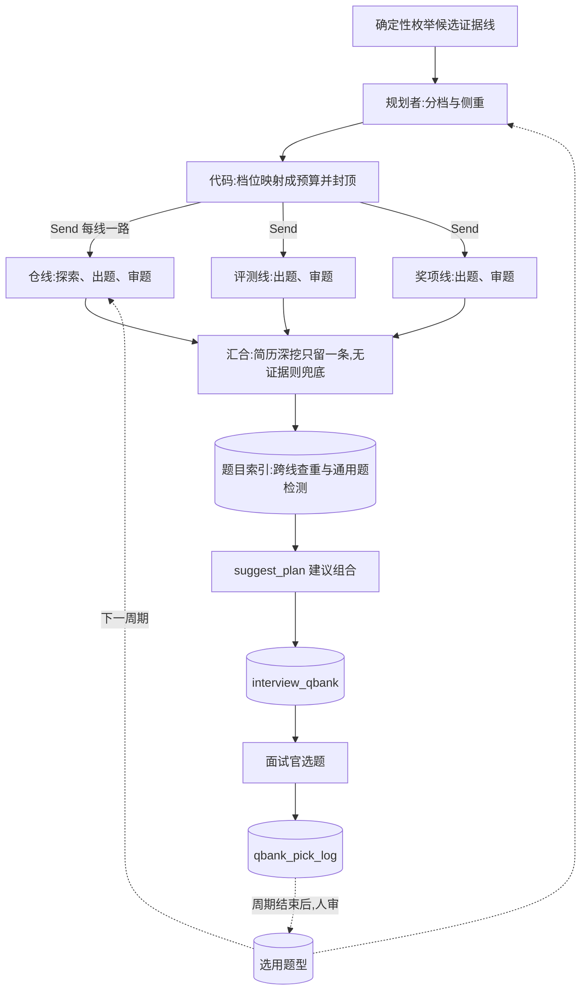

# 调查出题群:规划者 + 并行探索者 + 对抗审题

> 提案 v0.1 · 2026-11-11 · 状态:未立项。范围 = B 模块出题线(`evaluation/bundle.py`、
> `evaluation/investigate_graph.py`、`evaluation/explore.py`)与题库(`state/qbank.py`);
> **不改评分子图,不改面试官选题的交互**。共同约束见 [README](README.md)。

## 1. 背景与问题

现状(均可在代码里查到):

- `run_bundle` 依次跑四类证据线:仓线(每个可读的仓一条,调查子图 `route → explore → generate`)、
  评测线、奖项线,以上全无时的兜底线。最后 `suggest_plan` 给一个 15 分钟的建议组合。
- 仓线在一个 `for` 循环里**串行**。每条仓线的探索是受限循环,双闸为 80 轮 / 300 秒
  (`explore.MAX_TURNS`、`MAX_WALL_SECONDS`);仓线上限 5 条(`MAX_REPO_LINES`,注释写得很直白:
  不封顶就等于把成本开关交给候选人)。最坏情况下光探索就是 5 × 300 秒。
- 每个仓拿到的预算**一样**:一个 fork 来的教程仓和候选人写了半年的主项目,探索深度相同。
- 探索者把材料写进档案(`Dossier`,十个类别槽位,上限 4 万字符),出题者只看档案。这个上下文
  隔离做得对,本提案沿用。
- 出题有确定性校验(`validate_qbank_v2_group`:证据路径、链层数、对抗性措辞等),但**没有模型
  审题**。`qbank_judge` 是离线 eval,不在生产路径上。
- 各线各出各的题,**线与线之间不查重**;不同候选人之间也不知道哪些题其实是通用题。
- 面试官选了哪些题记在 `qbank_pick_log` 里,目前没有任何地方用它。

| 问题 | 表现 |
|---|---|
| 慢 | 多仓简历的出题耗时随仓数线性增长 |
| 预算不分轻重 | 探索轮数平均摊在不值得深挖的仓上 |
| 没有第二双眼睛 | 「搜一下就能答」「背得出来」的题只能等面试官自己筛掉 |
| 题目重复 | 同一个点在两条线上各问一遍;不同候选人拿到近乎相同的题 |
| 选题信号没回流 | 面试官的偏好年年重新摸索 |

## 2. 目标与非目标

**目标**

1. 现有证据线并行跑,出题耗时不再随仓数线性增长。
2. 探索预算按证据线的价值分档,总预算有硬上限。
3. 每道题在出库前过一遍独立审题,先标注,证据充分后再拦截。
4. 题目向量索引:包内查重,跨候选人识别通用题。
5. 面试官选用的题沉淀成去标识的「题型」,作为出题范例。

**非目标**

- 不放宽 `MAX_REPO_LINES`,不让模型或候选人决定预算数值。
- 不改调查子图内部的路由与归属判断。
- 不做「一个大出题者看全部档案」(D4)。
- 不让审题者改写题目(它只有放行、打回、丢弃三种意见)。
- 不把面试官没选的题当负例(D9)。

## 3. 总体流程



## 4. 关键决策

### D1 · 第一步只做并行化,不加任何新角色

把 `run_bundle` 里的串行循环改成并发,就能拿到最大的一块收益,而且不增加一次模型调用。要处理的
只有一个线间依赖:**简历深挖全局只出一条线**。现在靠 `cv_dive_done` 按顺序传递——前面的线走了
简历深挖,后面读不到仓的线就直接跳过。

并行后的做法:各线不再互相等,汇合时由代码按线的原始顺序保留第一条简历深挖组,丢掉其余。代价是
极少数情况下多花一次出题调用(可读的仓在子图内探测时恰好瞬时失败才会触发),换来的是线间没有
共享的可变状态。

并发度受两个闸约束:评估域并发闸(见 README),以及 `GitHubClient` 上的请求并发上限——并行的
探索者共用同一个令牌的速率配额。

### D2 · 规划者只选档位和侧重,预算由代码映射并封顶

规划者是单次调用。输入是代码枚举出来的候选线(仓名、仓的元信息、归属级别)和简历里的项目
文本;输出是每条线的档位与侧重类别。

| 档位 | 探索双闸(初值) | 典型对象 |
|---|---|---|
| `high` | 80 轮 / 300 秒 | 归属可信的主项目 |
| `normal` | 40 轮 / 180 秒 | 一般的自有仓 |
| `low` | 20 轮 / 90 秒 | fork、教程仓、课程作业模板 |

约束都在代码里,模型越不过去:

- 规划者**不能发明证据线**:输出的线必须是候选集合的子集,多出来的丢弃。
- 侧重类别必须取自现有的十个档案类别(`schema.CATEGORY`)。
- 整包硬上限:并行探索者至多 3 个,总探索轮数与整包墙钟各有上限;超出时从低档往下砍。
- `high` 档就是今天所有仓线的默认值——规划者只能**省**预算,不能加。

侧重提示放进探索者的**用户消息**,不进 system 文本:探索的 system 文本保持稳定是现有的缓存纪律。

规划者失败或输出不合规时,所有线退回今天的默认(全部 `high`、无侧重)。规划是优化,不是依赖。

### D3 · 探索者之间上下文隔离

每个探索者有自己的档案和自己的预算,互相看不到。回到主流程的只有出题结果和用量——仓里的文件
原文不离开那条线。这与现状一致,并行之后更要守住:一个仓里的注入文本不应该有机会影响另一条线。

### D4 · 出题仍然每线一次;跨线只做组合与去重

没有采用「探索者只交档案,由一个出题者统一出题」的方案,原因有三:

- 证据路径校验是按仓做的,合并出题后一道题的证据属于哪个仓会变得含糊;
- 五份档案加起来可以到 20 万字符,一次调用塞不下也读不好;
- 一条线失败只影响一组题的隔离性会丢掉。

跨线要做的事——去重、挑出建议组合——用代码和向量索引就够了(D7 与现有的 `suggest_plan`)。

### D5 · 独立审题者:先只标注,有证据再拦截

审题者是单次调用,在每条线内部、出题之后跑一次,看到的是该线的题组和它的证据材料(仓线是
档案)。先过确定性检查(现有的对抗性措辞表等),再由模型逐题给意见:

| 意见 | 含义 |
|---|---|
| `keep` | 放行 |
| `revise` | 打回,附理由 |
| `drop` | 建议丢弃,附理由 |

理由取自固定的集合:

| 理由 | 含义 |
|---|---|
| `searchable` | 搜一下就能答,和候选人的项目无关 |
| `ungrounded` | 题目声称的事实在档案里找不到 |
| `recitable` | 背八股就能答,问不出是不是自己做的 |
| `duplicate` | 与同组里另一道题问的是同一件事(跨线的重复由题目索引处理,见 D7) |
| `generic` | 换一份简历照样能问 |
| `tone` | 质问、设套、让人难堪的措辞 |

两种模式,由配置切换:

- **`annotate`(默认)**:只把意见挂在题上,题库原样落库。面试官看得到标注,选题数据可以反过来
  检验审题者准不准。
- **`enforce`**:`revise` 的题打回出题者改一次;`drop` 的题丢弃——前提是丢掉之后题组仍然满足
  现有的结构约束,否则保留并标注。

`enforce` 只在 eval 证明审题者的误杀率够低之后才开。审题者没有改写权:它改的题没有人再审。

### D6 · 审题标准与离线 judge 分开

`qbank_judge` 按相关性、具体性、公平性、区分度四个维度给整套题打分,是离线度量。在线审题者如果
用同一套标准,就成了「对着考卷改答案」——judge 分数会涨,但不说明题目变好了。

所以两者的标准故意不同:审题者做逐题的缺陷检查(D5 的理由集合),judge 做整套题的质量评分。
最终的裁判是人:面试官的选题记录,以及 `cv_dive_report` 的人工评审。

### D7 · 题目向量索引

每道可选的题落一行索引,主键沿用题库现有的稳定题引用 id(`state/qbank.py` 的 `_ref_id`),
这样和选题记录天然对得上。

两个用途:

- **包内查重**:同一份简历的各线之间,相似度过门槛的题只保留证据更强的一道(仓线优先于简历线)。
- **通用题检测**:一道题如果和至少 N 份其他简历的题近乎相同,标 `generic`。入口题允许通用(开场
  本来就是通用的),链题和备选题不允许。

只在本周期内比较。嵌入模型与知识库同一个,遵守 README 的向量表纪律。

### D8 · 范例只用去标识的「题型」

面试官选过的题带着候选人的项目细节,不能直接拿去给另一份简历当范例。沉淀的是**题型**:把具体
项目抹掉后的提问模式,例如「让候选人解释某个提交里为什么改了数据结构」。

题型由离线一次调用从选用记录里归纳,人审通过后才生效(共同约束第 8 条)。检索时按档案类别与
年级带过滤,取少量几条放在出题 prompt 的范例段,包数据区,并声明「范例只说明提问方式」。

### D9 · 选用是弱正例,没选不是负例

面试官选题有很强的位置偏差(排在前面的更容易被选)和时间约束(15 分钟只能问几道)。所以:

- 被多位面试官、在多份简历上反复选用的**题型**,才当作正例;
- 没被选的题不说明任何问题,不进任何负例集合;
- 题型的统计只用聚合计数,不记到具体面试官头上。

### D10 · 失败语义

| 失败点 | 语义 |
|---|---|
| 规划者失败 | 退回默认计划(D2) |
| 单条证据线失败 | 降级为空的错误组,不炸整包(与现状相同) |
| 审题者失败 | 题目原样放行,标注「审题不可用」 |
| 题目索引写入或检索失败 | 跳过查重,题库照常落库 |
| 范例检索失败 | 不带范例出题 |
| 整包失败 | 只影响出题状态,不影响已落库的评分卡(与现状相同) |

出题线全程只读,没有任何一步需要 fail-closed。

## 5. 数据面(示意)

题库信封升到 `evaluation_qbank/v3`:增加 `plan`(每条线的档位、侧重、实际用掉的预算),每道题
增加可选的 `review`(意见、理由、审题 prompt 版本)。题目模型是严格模式(`extra="forbid"`),所以
要改 `evaluation/schema.py`,并让 `save_qbank` 同时接受 v2 与 v3;选题接口对没有 `review` 的旧题
按未审处理。

```sql
CREATE TABLE IF NOT EXISTS qbank_question_index (
    ref_id        text        PRIMARY KEY,
    resume_id     bigint      NOT NULL,
    cycle_id      int         NOT NULL,
    qbank_version int         NOT NULL,
    group_kind    text        NOT NULL,
    category      text,
    question      text        NOT NULL,
    picked        boolean     NOT NULL DEFAULT false,
    embedding     vector      NOT NULL,
    embed_model   text        NOT NULL,
    created_at    timestamptz NOT NULL DEFAULT now()
);

CREATE TABLE IF NOT EXISTS qbank_exemplar (
    exemplar_id  bigserial   PRIMARY KEY,
    category     text        NOT NULL,
    grade_band   text        NOT NULL DEFAULT '',
    pattern      text        NOT NULL,
    pick_count   int         NOT NULL DEFAULT 0,
    source_refs  jsonb       NOT NULL DEFAULT '[]',
    status       text        NOT NULL DEFAULT 'proposed'
                 CHECK (status IN ('proposed', 'approved', 'retired')),
    approved_by  int,
    embedding    vector      NOT NULL,
    embed_model  text        NOT NULL,
    created_at   timestamptz NOT NULL DEFAULT now()
);
```

题目文本进索引前过脱敏;`source_refs` 只存题引用 id,不存题文。

## 6. 角色

| 角色 | 形态 | 看得到 | 产出 | prompt |
|---|---|---|---|---|
| 规划者(新) | 单次调用,无工具 | 候选线的元信息、项目文本 | 每线的档位与侧重 | `evaluation/plan.md` |
| 探索者(已有) | 受限循环,只读 GitHub 工具 | 一个仓 | 档案 | `evaluation/explore.md`,不变 |
| 出题者(已有) | 单次调用 | 一条线的档案 | 题组 | `evaluation/grilling.md` 等,增加范例段 |
| 审题者(新) | 单次调用,无工具 | 一条线的题组与档案 | 逐题意见 | `evaluation/question_review.md` |

## 7. 安全与失败语义

失败语义见 D10;这里只列安全属性。

- 仓内容、简历、往届题型都是不可信输入:工具返回过 `guard_tool_result`(已有),进 prompt 包
  数据区。
- 规划者的输出只在代码定义的枚举里取值,注入最多让某条线降档,不能加预算、加线或换工具。
- 审题者看到的题目是模型产出、与仓内容同源,同样包数据区;它的意见只在固定集合里取值。
- 预算封顶在代码里,这是出题线最重要的一条安全属性:候选人能影响的只有「有几条候选线」,而那
  已经被 `MAX_REPO_LINES` 封住。

## 8. eval 与门禁

| suite | 性质 | 断言 |
|---|---|---|
| `qbank_probes`(已有) | 真模型 | 结构与证据性质不退化 |
| `qbank_judge`(已有) | 真模型 | 四维评分不低于基线 |
| `cv_dive_report`(已有) | 人工评审 | 简历深挖质量 |
| `plan_probes`(新) | 确定性 + 真模型 | 任何输入下预算上限不被突破;fork 与教程仓落在低档;规划者失败时退回默认 |
| `question_review_probes`(新) | 真模型 | 植入的坏题(可搜、无出处、通用、措辞不当)被标出;历史上被选用的好题不被判 `drop` |

并行化(P1)的验收不需要新 suite:同一批简历上题库质量指标不降,整包墙钟下降,token 持平。

## 9. 成本与预算闸

- P1 不增加调用,只缩短墙钟。
- 规划者每份简历多一次小调用;它省下的是低档线上的探索轮数,净效果预期是省。
- 审题者每条有题的线多一次调用,输入是档案加题组——档案是出题时刚用过的前缀,排布得当可以
  命中缓存。
- 整包预算硬上限写在配置里,规划者、候选人都改不了。

## 10. 分期

| 期 | 内容 | 验收 |
|---|---|---|
| P1 | 现有证据线并行化;简历深挖在汇合处去重;GitHub 并发闸 | 多仓简历的整包墙钟明显下降,质量指标不降 |
| P2 | 审题者(只标注)+ 题目索引(包内查重、通用题标注) | `question_review_probes` 通过;标注随题库可见 |
| P3 | 规划者与分档预算 | `plan_probes` 通过;探索总轮数下降而 judge 评分不降 |
| P4 | 审题拦截模式;选用题型范例 | 需要至少一个周期的选题数据;误杀率达标后才开拦截 |

## 11. 代码落位

- `evaluation/bundle.py`:串行循环改并发,汇合处去重;`evaluation/explore.py` 的双闸从模块常量
  改成参数(默认值不变)。
- `evaluation/plan.py`(新):候选线枚举、档位到预算的映射、封顶——纯函数,可单测。
- `evaluation/question_review.py`(新):确定性预检 + 审题调用。
- `state/qbank.py`:接受 v3 信封;`state/qbank_index.py`(新):题目索引与题型表。
- `evaluation/github_client.py`:请求并发上限。
- `prompts/evaluation/plan.md`、`prompts/evaluation/question_review.md`,以及对应的 eval 执行器。

## 12. 开放问题

1. 档位的三组双闸数值是拍的,要用 P1 上线后的真实用量分布校准(多少线其实在 20 轮内就结束了)。
2. 包内查重与通用题检测的相似度门槛,要先用现有题库离线量一遍分布。
3. 审题标注要不要展示给面试官,还是只进数据——展示会影响选题,进而污染对审题者的检验。
4. 题型归纳放在本提案还是并入[周期复盘](cycle-retrospective.md)统一做。
5. 通用题检测跨不跨周期:跨周期能发现「年年都问」的题,但要长期保留题目索引。
