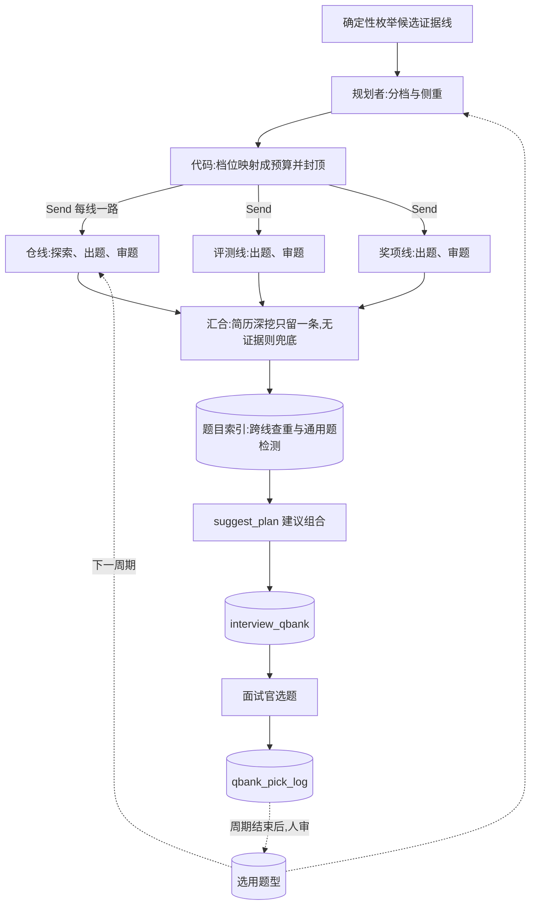

# 调查出题群:规划者 + 并行探索者 + 对抗审题

> 提案 v0.1 · 2026-11-11 · 状态:**P1 已实现**(证据线并发、汇合处去重、GitHub 请求并发闸;
> 真实模型下的墙钟与质量对比尚未跑)。**P2 的机制已实现但默认关闭,验收未完成**(审题者只
> 标注 + 题目索引;`question_review_probes` 没有在真实模型上跑过,相似度门槛没有校准,见 §10
> 进度)。P3–P4 未立项。范围 = B 模块出题线
> (`evaluation/bundle.py`、`evaluation/investigate_graph.py`、`evaluation/explore.py`)与题库
> (`state/qbank.py`);**不改评分子图,不改面试官选题的交互**。共同约束见 [README](README.md)。

## 1. 背景与问题

P1 之前的现状(「串行」那一条 P1 已经改掉,留在这里说明问题从哪来;其余仍可在代码里查到):

- `run_bundle` 依次跑四类证据线:仓线(每个可读的仓一条,调查子图 `route → explore → generate`)、
  评测线、奖项线,以上全无时的兜底线。最后 `suggest_plan` 给一个 15 分钟的建议组合。
- 仓线在一个 `for` 循环里**串行**。每条仓线的探索是受限循环,双闸为 80 轮 / 300 秒
  (`explore.MAX_TURNS`、`MAX_WALL_SECONDS`);仓线上限 5 条(`MAX_REPO_LINES`,注释写得很直白:
  不封顶就等于把成本开关交给候选人)。最坏情况下光探索就是 5 × 300 秒。
- 每个仓拿到的预算**一样**:一个 fork 来的教程仓和候选人写了半年的主项目,探索深度相同。
- 探索者把材料写进档案(`Dossier`,十个类别槽位,上限 4 万字符),出题者只看档案。这个上下文
  隔离做得对,本提案沿用。
- 出题有确定性校验(`validate_qbank_v2_group`:证据路径、链层数、对抗性措辞等),但**没有模型
  审题**。`qbank_judge` 是离线 eval,不在生产路径上。
- 各线各出各的题,**线与线之间不查重**;不同候选人之间也不知道哪些题其实是通用题。
- 面试官选了哪些题记在 `qbank_pick_log` 里,目前没有任何地方用它。

| 问题 | 表现 |
|---|---|
| 慢 | 多仓简历的出题耗时随仓数线性增长 |
| 预算不分轻重 | 探索轮数平均摊在不值得深挖的仓上 |
| 没有第二双眼睛 | 「搜一下就能答」「背得出来」的题只能等面试官自己筛掉 |
| 题目重复 | 同一个点在两条线上各问一遍;不同候选人拿到近乎相同的题 |
| 选题信号没回流 | 面试官的偏好年年重新摸索 |

## 2. 目标与非目标

**目标**

1. 现有证据线并行跑,出题耗时不再随仓数线性增长。
2. 探索预算按证据线的价值分档,总预算有硬上限。
3. 每道题在出库前过一遍独立审题,先标注,证据充分后再拦截。
4. 题目向量索引:包内查重,跨候选人识别通用题。
5. 面试官选用的题沉淀成去标识的「题型」,作为出题范例。

**非目标**

- 不放宽 `MAX_REPO_LINES`,不让模型或候选人决定预算数值。
- 不改调查子图内部的路由与归属判断。
- 不做「一个大出题者看全部档案」(D4)。
- 不让审题者改写题目(它只有放行、打回、丢弃三种意见)。
- 不把面试官没选的题当负例(D9)。

## 3. 总体流程



## 4. 关键决策

### D1 · 第一步只做并行化,不加任何新角色

把 `run_bundle` 里的串行循环改成并发,就能拿到最大的一块收益,而且不增加一次模型调用。要处理的
只有一个线间依赖:**简历深挖全局只出一条线**。现在靠 `cv_dive_done` 按顺序传递——前面的线走了
简历深挖,后面读不到仓的线就直接跳过。

并行后的做法:各线不再互相等,汇合时由代码按线的原始顺序保留第一条简历深挖组,丢掉其余。代价是
极少数情况下多花一次出题调用(可读的仓在子图内探测时恰好瞬时失败才会触发),换来的是线间没有
共享的可变状态。

并发度受两个闸约束:评估域并发闸(见 README),以及 `GitHubClient` 上的请求并发上限——并行的
探索者共用同一个令牌的速率配额。

**P1 落地时的取舍**(与上文不一致处以这里为准):

- **扇出用 `asyncio.gather`,不是 `Send`**。`run_bundle` 本身不是图,各线是普通协程;等规划者
  (P3)进来、编排需要成图时再换。仓线、评测线、奖项线三路同时跑,分线前的仓可读性探测也并发。
- **仓线并发度在包内先封顶 3**(`bundle.MAX_PARALLEL_REPO_LINES`),把 D2 的「并行探索者至多
  3 个」提前落了地。封顶的 5 条仓线分两批跑完:整包墙钟约为最慢一条线的两倍,而不是五条之和。
- **评估域模型并发闸在 P2 补上了**(P1 上线时没有它:一个 bundle 的模型调用峰值是 4——3 条
  仓线加评测线——4 个 job 同时在题库段时评估域峰值到 16)。现在评分、探索、出题、审题的每一次
  模型调用都先过 `llm_common.model_gate()`,进程内一把,上限是配置项
  `EVALUATION_MODEL_CONCURRENCY`(默认 8,即把上面的 16 封到 8)。8 没有按模型供应商的限流实测
  过:模型侧一旦限流,表现不是报错而是探索降级、题目变薄,见到这种迹象就调小。评分子图没有
  改代码,它本来就经 `invoke_with_retry` 调模型,闸设在那里面。**排队等闸的时间不计入探索的
  300 秒墙钟**:预算管的是探索自己花多久,不该因为别的 job 忙而让这条线的档案变薄;代价是整包
  墙钟在忙时没有硬上限(runner 对在跑的 job 没有超时回收,所以不会因此重复执行)。
- **GitHub 请求闸**:`github_client.MAX_CONCURRENT_REQUESTS = 4`,进程内所有 client 共用(各线
  各建各的 client),包住全部出站请求。取 4 是让峰值不高于「每个 job 同一时刻只发一个请求」的
  水平。闸只限并发,不做 `Retry-After` 退避:被限流仍按「仓不可读」降级,与现状相同。
- **「丢掉其余」= 整组不进信封**,留一条 `bundle_cv_dive_dedup` 日志;被丢掉的线花的 token 仍
  计入 `explore_usage_total`(用量在去重之前聚合)。这与分线阶段「读不到的仓只留一条线」的
  处理一致:多出来的仓在信封里不留痕。
- **多花的调用不是独立小概率事件**。触发条件是「探测时可读、进子图时读不到」,而限流会让同一
  批线一起读不到:最坏是每条仓线各做一次简历深挖(各含一次技术栈抽取和一次出题),上限 5 条。
  第一批线紧跟着探测起跑,窗口只有一次请求那么长;排在第二批的线要等前一批跑完,窗口是分钟
  级的。两种情况都与 GitHub 限流正相关。
- 子图的 `cv_dive_done` 参数保留(非目标:不改子图路由),`run_bundle` 不再传它(§12 第 8 条)。

### D2 · 规划者只选档位和侧重,预算由代码映射并封顶

规划者是单次调用。输入是代码枚举出来的候选线(仓名、仓的元信息、归属级别)和简历里的项目
文本;输出是每条线的档位与侧重类别。

| 档位 | 探索双闸(初值) | 典型对象 |
|---|---|---|
| `high` | 80 轮 / 300 秒 | 归属可信的主项目 |
| `normal` | 40 轮 / 180 秒 | 一般的自有仓 |
| `low` | 20 轮 / 90 秒 | fork、教程仓、课程作业模板 |

约束都在代码里,模型越不过去:

- 规划者**不能发明证据线**:输出的线必须是候选集合的子集,多出来的丢弃。
- 侧重类别必须取自现有的十个档案类别(`schema.CATEGORY`)。
- 整包硬上限:并行探索者至多 3 个,总探索轮数与整包墙钟各有上限;超出时从低档往下砍。
- `high` 档就是今天所有仓线的默认值——规划者只能**省**预算,不能加。

侧重提示放进探索者的**用户消息**,不进 system 文本:探索的 system 文本保持稳定是现有的缓存纪律。

规划者失败或输出不合规时,所有线退回今天的默认(全部 `high`、无侧重)。规划是优化,不是依赖。

### D3 · 探索者之间上下文隔离

每个探索者有自己的档案和自己的预算,互相看不到。回到主流程的只有出题结果和用量——仓里的文件
原文不离开那条线。这与现状一致,并行之后更要守住:一个仓里的注入文本不应该有机会影响另一条线。

### D4 · 出题仍然每线一次;跨线只做组合与去重

没有采用「探索者只交档案,由一个出题者统一出题」的方案,原因有三:

- 证据路径校验是按仓做的,合并出题后一道题的证据属于哪个仓会变得含糊;
- 五份档案加起来可以到 20 万字符,一次调用塞不下也读不好;
- 一条线失败只影响一组题的隔离性会丢掉。

跨线要做的事——去重、挑出建议组合——用代码和向量索引就够了(D7 与现有的 `suggest_plan`)。

### D5 · 独立审题者:先只标注,有证据再拦截

审题者是单次调用,在每条线内部、出题之后跑一次,看到的是该线的题组和它的证据材料(仓线是
档案)。先过确定性检查(现有的对抗性措辞表等),再由模型逐题给意见:

| 意见 | 含义 |
|---|---|
| `keep` | 放行 |
| `revise` | 打回,附理由 |
| `drop` | 建议丢弃,附理由 |

理由取自固定的集合:

| 理由 | 含义 |
|---|---|
| `searchable` | 搜一下就能答,和候选人的项目无关 |
| `ungrounded` | 题目声称的事实在档案里找不到 |
| `recitable` | 背八股就能答,问不出是不是自己做的 |
| `duplicate` | 与同组里另一道题问的是同一件事(跨线的重复由题目索引处理,见 D7) |
| `generic` | 换一份简历照样能问 |
| `tone` | 质问、设套、让人难堪的措辞 |

两种模式,由配置切换:

- **`annotate`(默认)**:只把意见挂在题上,题库原样落库。面试官看得到标注,选题数据可以反过来
  检验审题者准不准。
- **`enforce`**:`revise` 的题打回出题者改一次;`drop` 的题丢弃——前提是丢掉之后题组仍然满足
  现有的结构约束,否则保留并标注。

`enforce` 只在 eval 证明审题者的误杀率够低之后才开。审题者没有改写权:它改的题没有人再审。

**P2 落地时的取舍**(只实现了 `annotate`;与上文不一致处以这里为准):

- **意见挂在题组旁边,不进题目对象**。题目对象是出题模型的输出面:在那里留一个 `review`
  字段,出题模型(或仓里的注入文本)就能替自己的题预先填上「放行」。所以每条线的审题结果是
  信封上的一块 `review`(`schema.LineReview`:状态、逐题意见、审题 prompt 版本、用量),
  逐题意见用组内编号(`entry` / `chain:链:层` / `reserve:序号` / `question:序号`)对回题目;
  题库的可挑题视图读出时再把意见并到题上(§5.1)。审题 prompt 版本因此记在线上,不逐题重复。
- **「附理由」就是理由代号**,没有自由文本。审题者读到的题目与仓内容同源,让它写一句话等于给
  注入留一条落库的通道。结论与理由的搭配由代码校验:`keep` 不带理由,`revise` / `drop` 至少一条。
- **审哪些线**:题目由模型依据证据材料写成的三种——仓深挖、简历深挖、评测线。通用引导题
  (材料读不到时的兜底,通用是它的本分)、奖项线(模板题)、兜底线(按定义就是通用题)不审。
- **入口题不记 `generic`**:prompt 里说了,代码里再剔一遍(模型给了也不算)。
- **确定性预检只有两条**:措辞词表(与出题后的结构校验共用一份,`investigate.ADVERSARIAL_WORDS`)
  和同文重复(标后出现的那道)。仓线的题在出题校验时已经过了词表,预检主要对评测线有用。模型
  判了 `keep` 而预检查出问题的题按 `revise` 算。
- **审题失败**:结果标 `unavailable`,题目原样放行,只留预检查出来的那几条(D10)。
- **开关是 `QBANK_REVIEW_MODE`,默认 `off`**,不是 `annotate`。审题给每条有题的线多加一次
  strong 调用,输入是整份档案;而它的 prompt 还没有在真实模型上跑过一次(开发机没有模型 key)。
  打开的前提是 `question_review_probes` 跑过并达标(§8)。`enforce` 这个取值 P2 不认,按 `off` 处理。
- **缓存命中做不到**(§9 原来的设想):审题与出题是两份 prompt,开头不同,档案不是共同前缀。
  要命中得改出题 prompt 的排布,那会动到出题行为,不在 P2 里做。

### D6 · 审题标准与离线 judge 分开

`qbank_judge` 按相关性、具体性、公平性、区分度四个维度给整套题打分,是离线度量。在线审题者如果
用同一套标准,就成了「对着考卷改答案」——judge 分数会涨,但不说明题目变好了。

所以两者的标准故意不同:审题者做逐题的缺陷检查(D5 的理由集合),judge 做整套题的质量评分。
最终的裁判是人:面试官的选题记录,以及 `cv_dive_report` 的人工评审。

### D7 · 题目向量索引

每道可选的题落一行索引,主键沿用题库现有的稳定题引用 id(`state/qbank.py` 的 `_ref_id`),
这样和选题记录天然对得上。

两个用途:

- **包内查重**:同一份简历的各线之间,相似度过门槛的题只保留证据更强的一道(仓线优先于简历线)。
- **通用题检测**:一道题如果和至少 N 份其他简历的题近乎相同,标 `generic`。入口题允许通用(开场
  本来就是通用的),链题和备选题不允许。

只在本周期内比较。嵌入模型与知识库同一个,遵守 README 的向量表纪律。

**P2 落地时的取舍**(与上文不一致处以这里为准):

- **只标注,不删题**。包内查重没有「只保留一道」:证据弱的那道记 `duplicate_of`,指向留下的
  那道;通用题记 `generic_resumes`(有几份其他简历出过近似的题)。删题要等 P4 的拦截模式——
  门槛没有校准之前删题,等于拿一个拍出来的数字替面试官做决定,而且从链里抽掉一层会破坏题组结构。
- **入口题不会被标**(既不记重复也不记通用):各线的开场题措辞相近是正常的。它仍可以是别的
  题的「强题」。
- **证据强弱的次序**:仓线 > 评测线 > 简历线 > 奖项线 > 兜底线;同类按线的先后。两道以上
  留下的题都过门槛时,指向最像的那道。同一组里的重复不归索引管(那是审题者的 `duplicate`)。
- **标注放在信封顶层的 `similarity`**,按「组下标 + 组内编号」定位,理由同 D5:不进题目对象。
- **这一步在 runner 的题库段,不在 bundle 里**(§3 的流程图把它画在 `suggest_plan` 之前)。
  标注要写进信封,所以在落库前;索引行的主键是稳定题引用 id,而它含题库版本,版本要落库后才有,
  所以写索引在落库后。P2 的标注不影响建议组合,先后不要紧。
- **索引表**(`state/qbank_index.py`,§5):没有 `picked` 列——主键就是题引用 id,与选题记录
  关联即可;多了 `role`;向量列不带维度,比较时用 `CASE` 把不同模型的行挡在外面(换模型后新旧
  向量维度不同,直接比会报错);一份简历在一个周期里只留最新一版题库的行。
- **开关是 `QBANK_INDEX_ENABLED`,默认关**。三个数——`QBANK_DUPLICATE_MIN_SIMILARITY`、
  `QBANK_GENERIC_MIN_SIMILARITY`(都是 0.9)、`QBANK_GENERIC_MIN_RESUMES`(3)——全是初值,
  没有拿任何真实题库量过(§12 第 2 条)。打开还需要 `EMBED_*` 已配置、题库所在的库装有 pgvector;
  缺任何一样都只是没有标注,题库照常落库。
- **没有回填工具**:开关打开之前落库的题库不在索引里。要「先拿现有题库量一遍分布」,得先写一个
  把 `interview_qbank` 里的旧信封重新算向量入索引的脚本——这件事 P2 没有做。
- 题文在算向量、入索引之前过 `mask_pii`。

### D8 · 范例只用去标识的「题型」

面试官选过的题带着候选人的项目细节,不能直接拿去给另一份简历当范例。沉淀的是**题型**:把具体
项目抹掉后的提问模式,例如「让候选人解释某个提交里为什么改了数据结构」。

题型由离线一次调用从选用记录里归纳,人审通过后才生效(共同约束第 8 条)。检索时按档案类别与
年级带过滤,取少量几条放在出题 prompt 的范例段,包数据区,并声明「范例只说明提问方式」。

### D9 · 选用是弱正例,没选不是负例

面试官选题有很强的位置偏差(排在前面的更容易被选)和时间约束(15 分钟只能问几道)。所以:

- 被多位面试官、在多份简历上反复选用的**题型**,才当作正例;
- 没被选的题不说明任何问题,不进任何负例集合;
- 题型的统计只用聚合计数,不记到具体面试官头上。

### D10 · 失败语义

| 失败点 | 语义 |
|---|---|
| 规划者失败 | 退回默认计划(D2) |
| 单条证据线失败 | 降级为空的错误组,不炸整包(与现状相同) |
| 审题者失败 | 题目原样放行,标注「审题不可用」 |
| 题目索引写入或检索失败 | 跳过查重,题库照常落库 |
| 范例检索失败 | 不带范例出题 |
| 整包失败 | 只影响出题状态,不影响已落库的评分卡(与现状相同) |

出题线全程只读,没有任何一步需要 fail-closed。

P1 的落地形态:仓线失败留一个 `mode=error` 的错误组;评测线、奖项线失败是整线缺席(沿用各线
原有的语义)。并发之后多了一层兜底——线内没料到的异常也止步于该线(`bundle._contained`),
否则整包失败之外,其余还在跑的线会成为没人收结果的孤儿任务,白花模型调用。

## 5. 数据面

**信封没有升到 v3**(原设想是升版本,并在每道题上加 `review`)。P2 只增加可选字段,读方不需要
按版本分支,`save_qbank` 仍然只认 `evaluation_qbank/v2`;没有这些字段的旧题库按「未审」处理。
P3 的 `plan` 若也只是可选字段,同样不必升版本。

P2 新增的三处都**不在题目对象里**(理由见 D5):

| 位置 | 内容 | 何时出现 |
|---|---|---|
| `groups[i].qbank_v2.review` | 仓线(仓深挖 / 简历深挖)的审题结果 | 审题打开且该线过审;否则为 `null` |
| `groups[i].review` | 评测线的审题结果,形状同上 | 审题打开;否则没有这个键 |
| `similarity`(信封顶层) | 相似度标注 | 题目索引打开且 embedding 可用;否则没有这个键 |

```jsonc
// 一条线的审题结果(schema.LineReview)
{
  "status": "reviewed",              // reviewed | unavailable(审题模型没给出可用结果)
  "items": [                         // reviewed 时每道题一条;unavailable 时只有预检查出来的
    {"key": "entry",     "verdict": "keep",   "reasons": []},
    {"key": "chain:0:1", "verdict": "revise", "reasons": ["recitable"]},
    {"key": "reserve:2", "verdict": "drop",   "reasons": ["searchable", "generic"]}
  ],
  "prompt_version": "evaluation_question_review/v1",
  "usage": {"input_tokens": 0, "output_tokens": 0, "cache_hit_tokens": null, "cache_miss_tokens": null}
}

// 信封顶层的相似度标注:只列被标到的题
{
  "embed_model": "…",
  "items": [
    {"group_index": 1, "key": "reserve:0",
     "duplicate_of": {"group_index": 0, "key": "chain:0:0"},   // 本包里证据更强的那道;没有则 null
     "generic_resumes": 0}                                      // 几份其他简历出过近似的题;没被判通用则 0
  ]
}
```

题目索引表已建(`state/qbank_index.py`,惰性自举,不进启动流程);题型表属于 P4,仍是示意。

```sql
CREATE TABLE IF NOT EXISTS qbank_question_index (
    ref_id        text        PRIMARY KEY,           -- 稳定题引用 id,与选题记录对得上
    resume_id     bigint      NOT NULL,
    cycle_id      int         NOT NULL,
    qbank_version int         NOT NULL,
    group_kind    text        NOT NULL,
    role          text        NOT NULL,              -- entry / chain / reserve / question
    category      text        NOT NULL DEFAULT '',
    question      text        NOT NULL,              -- 已脱敏
    embedding     vector      NOT NULL,              -- 不带维度,见 D7
    embed_model   text        NOT NULL,
    created_at    timestamptz NOT NULL DEFAULT now()
);

-- P4,示意
CREATE TABLE IF NOT EXISTS qbank_exemplar (
    exemplar_id  bigserial   PRIMARY KEY,
    category     text        NOT NULL,
    grade_band   text        NOT NULL DEFAULT '',
    pattern      text        NOT NULL,
    pick_count   int         NOT NULL DEFAULT 0,
    source_refs  jsonb       NOT NULL DEFAULT '[]',
    status       text        NOT NULL DEFAULT 'proposed'
                 CHECK (status IN ('proposed', 'approved', 'retired')),
    approved_by  int,
    embedding    vector      NOT NULL,
    embed_model  text        NOT NULL,
    created_at   timestamptz NOT NULL DEFAULT now()
);
```

题目文本进索引前过脱敏;`source_refs` 只存题引用 id,不存题文。

### 5.1 给前端的契约(题库抽屉 / 打分工作台)

P2 **不新增接口,不新增权限点**。变化只是两个已有接口的返回里多了可选字段;后端两个开关都
关着时(默认),`pickable[]` 与现在完全一样,信封里只是每条仓线多一个值为 `null` 的 `review` 键。

**`GET /admin/evaluation/qbank?resume_id=&cycle_id=`**(权限不变:`interview:evaluate` 或
`resume:audit`)

`pickable[]` 的每一条可能多出两个键。没有标注的题**不带**这两个键,旧题库整体都没有:

| 键 | 形状 | 含义 |
|---|---|---|
| `review` | `{"verdict": "keep" \| "revise" \| "drop", "reasons": string[]}` | 审题意见。`keep` 时 `reasons` 为空 |
| `similarity` | `{"duplicate_of_ref_id": string \| null, "generic_resumes": number}` | `duplicate_of_ref_id` 是同一个 `pickable[]` 里另一条的 `ref_id`——本包里问同一件事、证据更强的那道;`generic_resumes` 大于 0 表示本周期有这么多份其他简历出过近似的题 |

`reasons` 的取值是固定的六个:

| 取值 | 含义 |
|---|---|
| `searchable` | 搜一下就能答,和候选人的项目无关 |
| `ungrounded` | 题目声称的事实在材料里找不到 |
| `recitable` | 背八股就能答,问不出是不是自己做的 |
| `duplicate` | 与同组里另一道题问的是同一件事 |
| `generic` | 换一份简历照样能问 |
| `tone` | 质问、设套、让人难堪的措辞 |

一条线有没有审过、审得成不成,看信封里的线级状态:仓线在
`envelope.groups[i].qbank_v2.review.status`,评测线在 `envelope.groups[i].review.status`,
取值 `reviewed` / `unavailable`;这块不存在或为 `null` 就是没审。`unavailable` 时个别题仍可能
带 `review`(确定性预检给的),其余题没有意见不等于「放行」。

**`POST /admin/evaluation/qbank/pick`**(不变)

请求体不变。把 `pickable` 条目原样传回(带着 `review` / `similarity`)或只传 `ref_id` 加
`question` 都可以,服务端按 `ref_id` 绑定。落进选题记录的是服务端的权威条目,带着勾选当时的
`review` / `similarity`——以后拿选题数据检验审题者,靠的就是这份快照。所以
`GET /admin/evaluation/qbank/picks` 返回的 `question_ref` 里也会出现这两个键。

**展示上要注意的两点**

- P2 是只标注:题目一道不少,前端不要默认按意见隐藏或过滤题目。
- 要不要默认展示给面试官还没有定(§12 第 3 条)——展示会影响选题,进而污染对审题者的检验。
  建议把这层展示做成可以整体关掉的。

## 6. 角色

| 角色 | 形态 | 看得到 | 产出 | prompt |
|---|---|---|---|---|
| 规划者(新) | 单次调用,无工具 | 候选线的元信息、项目文本 | 每线的档位与侧重 | `evaluation/plan.md` |
| 探索者(已有) | 受限循环,只读 GitHub 工具 | 一个仓 | 档案 | `evaluation/explore.md`,不变 |
| 出题者(已有) | 单次调用 | 一条线的档案 | 题组 | `evaluation/grilling.md` 等,增加范例段 |
| 审题者(新) | 单次调用,无工具 | 一条线的题组与档案 | 逐题意见 | `evaluation/question_review.md` |

## 7. 安全与失败语义

失败语义见 D10;这里只列安全属性。

- 仓内容、简历、往届题型都是不可信输入:工具返回过 `guard_tool_result`(已有),进 prompt 包
  数据区。
- 规划者的输出只在代码定义的枚举里取值,注入最多让某条线降档,不能加预算、加线或换工具。
- 审题者看到的题目是模型产出、与仓内容同源,同样包数据区;它的意见只在固定集合里取值。
- 预算封顶在代码里,这是出题线最重要的一条安全属性:候选人能影响的只有「有几条候选线」,而那
  已经被 `MAX_REPO_LINES` 封住。

## 8. eval 与门禁

| suite | 性质 | 断言 |
|---|---|---|
| `qbank_probes`(已有) | 真模型 | 结构与证据性质不退化 |
| `qbank_judge`(已有) | 真模型 | 四维评分不低于基线 |
| `cv_dive_report`(已有) | 人工评审 | 简历深挖质量 |
| `plan_probes`(新) | 确定性 + 真模型 | 任何输入下预算上限不被突破;fork 与教程仓落在低档;规划者失败时退回默认 |
| `question_review_probes`(新,已写,**未跑**) | 真模型 | 植入的坏题(可搜、无出处、通用、措辞不当)被标出;历史上被选用的好题不被判 `drop` |

并行化(P1)的验收不需要新 suite:同一批简历上题库质量指标不降,整包墙钟下降,token 持平。

落地时发现,上表已有的三个 suite **都不经过 `run_bundle`**:`qbank_probes` 喂的是校验器
(确定性,不调模型),`qbank_judge` 评的是固定题组,`cv_dive_report` 直接调调查子图。所以它们
通过只说明单线的出题与校验没有退化,测不到编排层。P1 的验收因此分两层:

- **编排行为**由单测覆盖(`tests/test_b4_bundle.py`、`tests/test_github_tools.py`):各线确实
  同时在跑、仓线并发度封顶、单线失败不影响在途的其他线、汇合处只留第一条简历深挖且用量不
  漏记、GitHub 在途请求数封顶。
- **墙钟与质量**要拿同一批多仓简历在改动前后各跑一遍真实初筛:墙钟看 runner 日志里
  `eval_event stage=qbank_done` 的 `duration_ms`;token 看 `agent_conversation_log` 里
  `channel='evaluation'` 的四列用量;质量看 `qbank_judge` 与 `cv_dive_report` 的人工评审。
  只想看编排本身能省多少墙钟,可以跑 `evals/benchmarks/bundle_wallclock_benchmark.py`
  (各线耗时为模拟值,不调模型)。

`question_review_probes` 的现状:数据集(`evals/datasets/question_review_probes.yaml`)与执行器
都已写好并进了 runner 的注册表,**没有在真实模型上跑过**——开发机没有模型 key,runner 如实报
SKIP。它出三个指标:

| 指标 | 含义 | 门槛(初值) |
|---|---|---|
| `planted_flag_rate` | 植入的坏题被标出来、且理由对得上的比例 | ≥ 0.7 |
| `good_not_dropped_rate` | 好题没有被判 `drop` 的比例 | = 1.0 |
| `good_keep_rate` | 好题被判 `keep` 的比例,即没有误伤 | 只记录;开拦截模式之前看它 |

三点要老实说明:数据集里的「好题」是手写的,不是历史上被选用过的题(还没有选题数据可取);
门槛是拍的,第一次跑出分布之后要重定并写基线;植入的坏题只有 7 道,够做冒烟,不够下结论。
题目索引没有对应的 suite:它不调模型,规则由单测覆盖,要校准的是门槛(§12 第 2 条)。

## 9. 成本与预算闸

- P1 不增加调用,只缩短墙钟。例外是 D1 记下的那一种:多条仓线同时回退到简历深挖时,多出来的
  几次出题调用在汇合处被丢弃。并发抬高的是峰值而不是总量(峰值见 D1)。
- 规划者每份简历多一次小调用;它省下的是低档线上的探索轮数,净效果预期是省。
- 审题者每条过审的线多一次 strong 调用,输入是档案加题组。原设想是「档案是出题时刚用过的
  前缀,可以命中缓存」,落地时发现做不到(D5)。审题在线内排在出题之后,所以抬高的是总量,
  不是并发峰值;它的用量与探索、出题一起计入 `explore_usage_total`。
- 题目索引每份题库多一次批量 embedding 调用和几十条短查询,不调对话模型。
- 整包预算硬上限写在配置里,规划者、候选人都改不了。

## 10. 分期

| 期 | 内容 | 验收 |
|---|---|---|
| P1 | 现有证据线并行化;简历深挖在汇合处去重;GitHub 并发闸 | 多仓简历的整包墙钟明显下降,质量指标不降 |
| P2 | 审题者(只标注)+ 题目索引(包内查重、通用题标注) | `question_review_probes` 通过;标注随题库可见 |
| P3 | 规划者与分档预算 | `plan_probes` 通过;探索总轮数下降而 judge 评分不降 |
| P4 | 审题拦截模式;选用题型范例 | 需要至少一个周期的选题数据;误杀率达标后才开拦截 |

**进度**:P1 已实现;P2 的机制已实现、默认关闭、**验收未完成**;P3 起未开工。两期的
`ruff check` 与全量单测都通过。

P1 没有做完的验收与留下的尾巴:

- **真实模型下的墙钟、token 与质量对比没有跑**(开发机没有模型 key;方法见 §8)。模拟耗时下,
  5 条仓线加评测线的整包墙钟约为逐条跑的 1/2.6——这只说明编排,不代表真实数字。
- 探索双闸改成参数(§11)没有做:只有规划者的分档预算用得到,留给 P3。
- 子图里的 `cv_dive_done` 参数在生产路径上已经没有调用方传 `True`(§12 第 8 条)。

P2 做了什么:审题者(只标注)、题目索引(包内跨线查重与跨简历通用题,只标注)、评估域模型
并发闸(D1)、`question_review_probes` 数据集与执行器、给前端的契约(§5.1)。

P2 **不能算验收通过**,原因和打开之前要做的事:

- `question_review_probes` 没有跑过。审题的 prompt 一次真实模型调用都没有经历过,所以
  `QBANK_REVIEW_MODE` 默认是 `off`。打开的顺序:有 key 的人先跑这个 suite(先用
  `--distribution` 看分布),按分布重定门槛并写基线,达标后再把配置改成 `annotate`。
- 相似度的三个数没有校准,也没有回填旧题库的工具(D7),所以 `QBANK_INDEX_ENABLED` 默认是关。
  打开之前先写回填脚本、量分布、重定门槛。
- 「标注随题库可见」只做到了接口:返回里有字段,前端还没有展示(另一个仓)。
- 评估域模型并发上限 8 是初值,没有对着模型供应商的限流实测过。

## 11. 代码落位

- `evaluation/bundle.py`:串行循环改并发,汇合处去重(P1 已落地);`evaluation/explore.py` 的
  双闸从模块常量改成参数(默认值不变,留给 P3)。
- `evaluation/plan.py`(新):候选线枚举、档位到预算的映射、封顶——纯函数,可单测。
- `evaluation/question_review.py`(P2 已落地):确定性预检 + 审题调用;审题段接在调查子图的
  出题之后(`investigate_graph.review_node`)和评测线上(`bundle._autograding_line`)。
- `evaluation/question_similarity.py`(P2 已落地,原稿没有列):相似度标注的编排——算向量、
  跨线查重、查通用题、落索引;由 `runner._do_qbank` 在题库落库前后各调一次。
- `state/qbank.py`:可挑题视图并入审题意见与相似度标注(P2 已落地;信封没有升 v3,见 §5);
  `state/qbank_index.py`(P2 已落地):题目索引。题型表留给 P4。
- `evaluation/llm_common.py`:评估域模型并发闸 `model_gate` / `gated_ainvoke`(P2 已落地)。
- `evaluation/github_client.py`:请求并发上限(P1 已落地)。
- `prompts/evaluation/plan.md`、`prompts/evaluation/question_review.md`,以及对应的 eval 执行器
  (`question_review.md` 与 `evals/question_review_probes.py` P2 已落地)。

## 12. 开放问题

1. 档位的三组双闸数值是拍的,要用 P1 上线后的真实用量分布校准(多少线其实在 20 轮内就结束了)。
2. 包内查重与通用题检测的相似度门槛,要先用现有题库离线量一遍分布。
3. 审题标注要不要展示给面试官,还是只进数据——展示会影响选题,进而污染对审题者的检验。
4. 题型归纳放在本提案还是并入[周期复盘](cycle-retrospective.md)统一做。
5. 通用题检测跨不跨周期:跨周期能发现「年年都问」的题,但要长期保留题目索引。
6. 仓线并发度 3 与 GitHub 请求闸 4 都是按「峰值不比并发前高太多」拍的,要用上线后的限流与
   降级日志校准(`bundle_cv_dive_dedup`、探索降级原因、模型侧 429)。
7. (已定,见 D1)排队等评估域模型并发闸的时间**不算**进探索的 300 秒墙钟。留下的问题是
   整包墙钟在忙时没有硬上限,要不要给题库段加一个总超时。
8. 子图的 `cv_dive_done` 参数要不要删:逐条跑线的调用方已经没有了,留着是为了不动子图路由。
9. 审题意见与相似度标注在同一道题上打架时(审题者放行,索引说通用)前端怎么合并展示,以及
   P4 的拦截模式以谁为准。
10. 通用题检测只看得到「已经入索引的简历」:一个周期里最早评的那批简历永远没有可比对象。
    要不要在周期中段对全部题库重算一遍标注。
